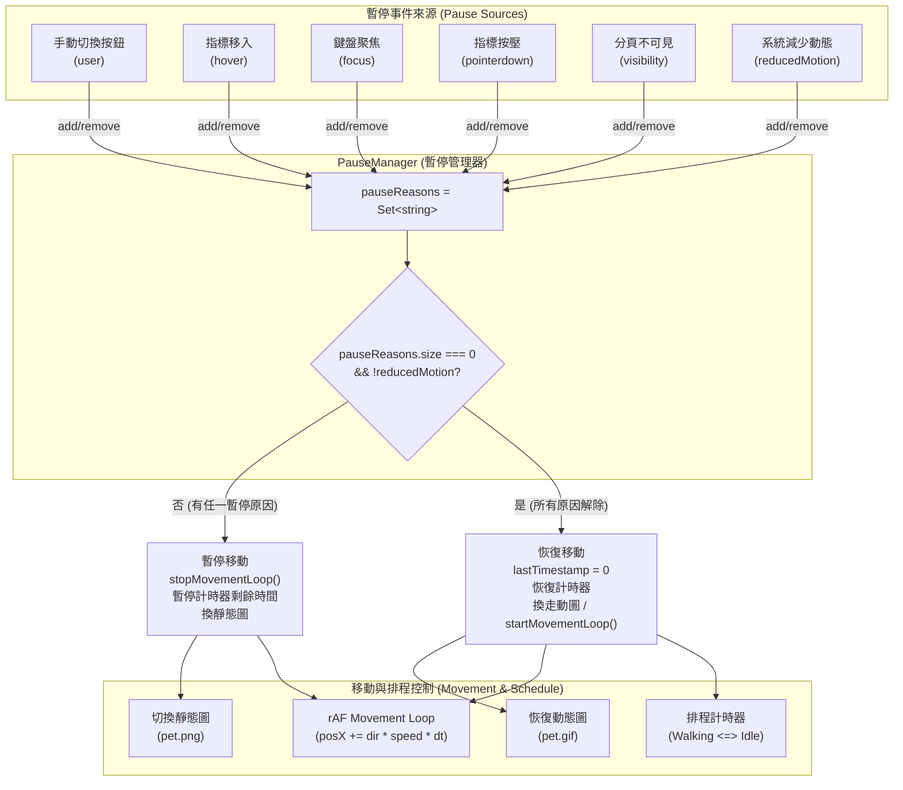
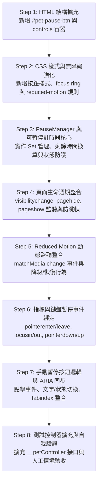

# PR2-PET-06C 實作規劃書：暫停、Reduced Motion 與生命週期

- **Task ID**: PR2-PET-06C
- **相關 PR**: PR #2 (`plan/pr2-bug-pet`)
- **文件狀態**: 規劃完成，等待人工審查（Planning Only）
- **撰寫日期**: 2026-10-15
- **基準 Commit**: `5b8d3e0` (fix(pet): 修正行走面向反向與 GIF 無限循環播放問題)

---

## 1. 現況分析（Current State）

### 1.1 現有程式架構與已完成功能
- **PR2-PET-05B / 06A / 06B 基線**：
  - 角色邏輯已完全隔離於 [js/pet.js](file:///Users/emma/Desktop/Web/js/pet.js)，初始化具備防重保護 (`window.__petInitialized`)。
  - 核心 FSM 定義四個狀態：`Walking`、`Idle`、`Happy`、`Hidden`，透過單一轉換入口 `transitionTo()` 執行狀態切換與排程清除 (`clearAllTimers()`)。
  - 移動機制採單一 `requestAnimationFrame`（`movementStep`），速度依視窗區分桌面（25–45 px/s）與手機（15–30 px/s），並有水平面向翻轉（`is-flipped`）與可視邊界安全區限制（`clampPosition`、`updateBoundaries`）。
  - 移動時長為隨機 4–8 秒，停留時長為隨機 2–5 秒（Happy 關閉後固定停留 2 秒）。
  - 對外暴露測試控制器 `window.__petController`，支援邊界、座標、狀態查詢與步進測試。

### 1.2 盤點發現的現有機制限制與差異
1. **Reduced Motion 僅靜態單次讀取**：
   - 目前 [js/pet.js](file:///Users/emma/Desktop/Web/js/pet.js#L69-L70) 僅在初始化時執行 `window.matchMedia('(prefers-reduced-motion: reduce)').matches`，且僅用於設定導覽捲動模式 `scrollBehavior = prefersReducedMotion ? 'auto' : 'smooth'`。
   - 角色移動未受限制：即使系統開啟減少動態偏好，角色依然在載入 2 秒後進入 `Walking` 狀態並播放 `picture/pet/pet.gif`。
   - 運作中切換系統動態偏好時，沒有監聽 `change` 事件，無法即時反應。
2. **無頁面生命週期（Page Lifecycle）防護**：
   - 缺乏 `visibilitychange`、`pageshow`、`pagehide` 事件監聽。
   - 當使用者切換至其他分頁時，雖然現代瀏覽器會降低或暫停 rAF 頻率，但 `setTimeout` 排程仍可能在背景觸發狀態轉換，造成狀態混亂。
   - 雖然 06B 在 rAF 中加入了 `MAX_DELTA_MS: 50` 限制，但分頁隱藏後未停止排程與 rAF，也未在背景換為靜態圖。
3. **缺乏 Hover / Focus / Pointerdown 暫停機制**：
   - 使用者欲點擊移動中的 Bug 先生，或以鍵盤 Tab 聚焦至角色按鈕時，角色仍持續移動，造成「目標逃走」、無法穩定操作的無障礙問題。
   - 目前 [css/style.css](file:///Users/emma/Desktop/Web/css/style.css#L559-L561) 僅有 `.pet:hover { transform: scale(1.07); }`，在 Reduced Motion 下亦未完全重設 hover transform。
4. **缺少手動暫停控制項**：
   - [index.html](file:///Users/emma/Desktop/Web/index.html#L92-L103) 中的 `#pet-dialog` 僅有 3 個導覽按鈕（作品、關於、聯絡），尚無「暫停走動／恢復走動」控制按鈕。
   - 現有 [js/pet.js](file:///Users/emma/Desktop/Web/js/pet.js#L65) 選擇器為 `.pet-options button`，並將所有按鈕綁定至導覽事件 `handleNavOptionClick`，若直接新增控制按鈕會被誤判為導覽項並自動關閉對話框。

---

## 2. 實作範圍（Scope）

### 2.1 允許修改的檔案
1. [js/pet.js](file:///Users/emma/Desktop/Web/js/pet.js)：
   - 實作獨立暫停原因管理器（`PauseManager`）。
   - 實作計時器剩餘時間暫停與恢復機制（`SuspendableTimer`）。
   - 整合 `visibilitychange` 與頁面生命週期監聽。
   - 整合 `prefers-reduced-motion` 即時監聽與動態切換處理。
   - 綁定 `.pet-guide` 的 `pointerenter`、`pointerleave`、`focusin`、`focusout`、`pointerdown`、`pointerup`、`pointercancel` 暫停事件。
   - 實作手動暫停／恢復按鈕邏輯與 `aria-pressed` / `tabindex` 同步。
   - 擴充 `window.__petController` 測試接口以利驗收測試。
2. [index.html](file:///Users/emma/Desktop/Web/index.html)：
   - 在 `#pet-dialog` 內新增專屬控制區塊及「暫停走動／恢復走動」原生按鈕（`#pet-pause-btn`）。
3. [css/style.css](file:///Users/emma/Desktop/Web/css/style.css)：
   - 新增手動暫停按鈕的視覺樣式（符合 44×44px 觸控標準、對比度與 focus-visible 樣式）。
   - 補充 `@media (prefers-reduced-motion: reduce)` 下 `.pet:hover` 的 `transform: none` 停用規則。
4. [docs/pr2-pet-06c-plan.md](file:///Users/emma/Desktop/Web/docs/pr2-pet-06c-plan.md)：
   - 本規劃文件。

### 2.2 明確排除事項（Out of Scope）
- **禁止提前進入 07A**：不更換 Happy 對話內容短句池、不實作獨立關閉按鈕、不綁定 Escape 關閉鍵、不調整對話框內所有按鈕的巡迴焦點順序。
- **禁止提前進入 07B**：不實作對話框在視窗邊界的 clamp 自動翻折，不實作對表單 input / footer 的自動避讓收起演算法。
- **禁止提前進入 08A / 08B**：不實作 Debug 按鈕、不使用 sessionStorage 持久化隱藏、不實作 Footer 召回按鈕。
- **禁止修改素材**：不修改或更名 [picture/pet/](file:///Users/emma/Desktop/Web/picture/pet/) 下的任何圖片檔案。
- **禁止重構無關模組**：不修改 [js/home.js](file:///Users/emma/Desktop/Web/js/home.js)、Matter.js 拉繩、表單邏輯或既有導覽機制。

---

## 3. 技術架構設計（Technical Design）



### 3.1 暫停原因管理器（PauseManager）
為防止多個暫停原因（例如使用者同時進行 Hover、鍵盤 Tab 聚焦且系統處於手動暫停）互相覆蓋，採用 `Set<string>` 集中管理：
```javascript
const pauseReasons = new Set();
// 支援的原因類型：
// 'user'          : 手動點擊「暫停走動」
// 'hover'         : 指標進入角色區塊 (.pet-guide)
// 'focus'         : 角色或對話框取得鍵盤焦點
// 'pointerdown'   : 觸控或滑鼠按下角色
// 'visibility'    : document.hidden === true
// 'reducedMotion' : prefers-reduced-motion: reduce 啟用
```
- **核心操作規則**：
  1. `addPauseReason(reason)`：
     - 若為首個加入的原因（`size === 0` 轉為 `size > 0`），觸發 `handlePauseActivated()`。
     - 停止 rAF（`stopMovementLoop()`）。
     - 暫停目前正在倒數的計時器，精確計算剩餘毫秒數（`remainingMs = Math.max(0, targetEndTime - Date.now())`）。
     - 若當前為 `Walking` 狀態，將角色圖片暫時置換為靜態待機圖 `picture/pet/pet.png`，避免在原地空踏步步伐。
  2. `removePauseReason(reason)`：
     - 自集合中刪除指定原因。
     - 僅在 `pauseReasons.size === 0` 且 `!prefersReducedMotion` 時，觸發 `handlePauseDeactivated()`。
  3. `isMovementAllowed()`：
     - 判定函式：`return pauseReasons.size === 0 && !prefersReducedMotion && currentState !== PET_STATES.HIDDEN && currentState !== PET_STATES.HAPPY;`

### 3.2 可暫停計時器（Suspendable Timer）
為避免分頁切換或暫停時「背景補跑時間」或「解除後立即瞬跳狀態」，將原先純 `setTimeout` 封裝為具備剩餘時間追蹤的排程結構：
```javascript
let activeTimer = {
    id: null,
    targetState: null,
    totalDuration: 0,
    startTime: 0,
    remainingMs: 0
};
```
- **暫停時**：
  - `clearTimeout(activeTimer.id)`。
  - `activeTimer.remainingMs = Math.max(0, activeTimer.totalDuration - (Date.now() - activeTimer.startTime))`。
- **恢復時**：
  - 若 `activeTimer.remainingMs > 0`，重設 `setTimeout`，時長為 `activeTimer.remainingMs`（設定下限 200ms 以避免極端微小間隔瞬發）。
  - 若無剩餘時間或前狀態無排程，依當前狀態重新隨機指派合理的過渡時長。

### 3.3 rAF 與時間戳記重設（Preventing Teleportation）
- 進入暫停或分頁切換時，調用 `stopMovementLoop()`，並將 `lastTimestamp = 0`。
- 當所有暫停解除且恢復 `Walking` 時：
  - `startMovementLoop()` 啟動時先將 `lastTimestamp = 0`。
  - 在 `movementStep(timestamp)` 的第一幀：
    - `if (!lastTimestamp) { lastTimestamp = timestamp; return; }`
    - 計算出的 `deltaMs` 強制限制在 `PET_CONFIG.MAX_DELTA_MS`（50ms）以內。
  - **保證**：從背景切回或解除長時間暫停後，第一幀 delta 為 0 或極小值，絕對不會發生跨螢幕瞬移。

### 3.4 頁面生命週期（Page Lifecycle）整合
監聽瀏覽器標準事件：
1. `document.addEventListener('visibilitychange', () => { ... })`：
   - `document.hidden === true`：調用 `addPauseReason('visibility')`。
   - `document.hidden === false`：調用 `removePauseReason('visibility')`。
2. `window.addEventListener('pagehide', () => { ... })`：
   - 分頁可能進入 bfcache（往返快取）或關閉，主動調用 `addPauseReason('visibility')`，停止所有 rAF 與計時器。
3. `window.addEventListener('pageshow', (e) => { ... })`：
   - 重新校正視窗尺寸 `updateBoundaries()`。
   - 重新檢查 `document.hidden` 與 `matchMedia`，若無暫停條件則調用 `removePauseReason('visibility')`。

### 3.5 Reduced Motion 動態偏好響應
1. **動態監聽**：
   ```javascript
   const motionQuery = window.matchMedia('(prefers-reduced-motion: reduce)');
   function handleMotionChange(e) {
       prefersReducedMotion = e.matches;
       scrollBehavior = prefersReducedMotion ? 'auto' : 'smooth';
       if (prefersReducedMotion) {
           addPauseReason('reducedMotion');
           if (currentState === PET_STATES.WALKING) {
               transitionTo(PET_STATES.IDLE);
           }
           setPetImage(PET_CONFIG.ASSETS.IDLE);
           updatePauseButtonState();
       } else {
           removePauseReason('reducedMotion');
           updatePauseButtonState();
       }
   }
   // 兼顧現代瀏覽器與舊版 Safari
   if (motionQuery.addEventListener) {
       motionQuery.addEventListener('change', handleMotionChange);
   } else if (motionQuery.addListener) {
       motionQuery.addListener(handleMotionChange);
   }
   ```
2. **行為契約**：
   - 啟用 Reduced Motion 時：
     - 若處於 `Walking`，立即轉為 `Idle`。
     - 自動排程禁止進入 `Walking`（角色永久維持在 `Idle` 或使用者觸發的 `Happy`）。
     - 禁止使用 `picture/pet/pet.gif`，一律使用靜態圖 `picture/pet/pet.png`（Happy 時使用 `pethappy.png`）。
     - 點擊互動、對話框展開、三個導覽連結及未來 Footer 召回功能均不受影響。
   - 手動暫停按鈕在 Reduced Motion 啟用時呈現停用狀態（`disabled`，提示「系統已減少動態」），不允許使用者手動覆寫系統級無障礙偏好。

### 3.6 手動暫停控制項（Manual Pause Button）
- **DOM 結構**：
  在 [index.html](file:///Users/emma/Desktop/Web/index.html) 的 `#pet-dialog` 內，將導覽按鈕與控制按鈕分開：
  ```html
  <div class="pet-dialog" id="pet-dialog" aria-hidden="true">
    <p>你好！想看看什麼呢？</p>
    <div class="pet-options">
      <button type="button" data-target="works-area">作品</button>
      <button type="button" data-target="profile-area">關於</button>
      <button type="button" data-target="contact-area">聯絡</button>
    </div>
    <div class="pet-controls">
      <button type="button" class="pet-control-btn pet-pause-btn" id="pet-pause-btn" aria-pressed="false">暫停走動</button>
    </div>
  </div>
  ```
- **邏輯契約**：
  - `userPaused` 旗標以頁面工作階段記憶體儲存，不寫入 `localStorage` 或 `sessionStorage`。
  - 點擊 `#pet-pause-btn` 時：
    - 切換 `userPaused = !userPaused`。
    - 若 `userPaused === true`：`addPauseReason('user')`，按鈕文字變更為「恢復走動」，`aria-pressed="true"`。
    - 若 `userPaused === false`：`removePauseReason('user')`，按鈕文字變更為「暫停走動」，`aria-pressed="false"`。
    - 阻止事件冒泡，不觸發導覽，對話框維持開啟，讓使用者能清楚確認切換狀態。
  - 對話框開啟／關閉時，此按鈕與其他選項一同納入 `tabindex`（`0` / `-1`）管理。

### 3.7 Hover / Focus / Pointerdown 暫停
- 監聽 `.pet-guide` 容器（確保滑鼠停在角色本體或開啟的對話框上方時皆能生效）：
  - `pointerenter`：`addPauseReason('hover')`。
  - `pointerleave`：`removePauseReason('hover')`。
  - `focusin`：`addPauseReason('focus')`。
  - `focusout`：`removePauseReason('focus')`。
  - `pointerdown`：`addPauseReason('pointerdown')`。
- 在 `window` 上監聽 `pointerup` 與 `pointercancel`：`removePauseReason('pointerdown')`，確保手指拖曳移出畫面或觸發點擊後能確實釋放。

---

## 4. 事件／狀態矩陣（Event / State Matrix）

| 當前狀態 | 觸發事件 | 暫停原因集合變化 | 次一狀態 | 視覺表現 (Image / Transform) | rAF / 計時器行為 |
| --- | --- | --- | --- | --- | --- |
| **Walking** | `pointerenter` (Hover) | `+ 'hover'` | Walking (暫停中) | 切換為 `pet.png`，原地靜止 | `stopMovementLoop()`，暫停走路計時器剩餘時間 |
| **Walking (暫停中)** | `focusin` (Tab 聚焦) | `+ 'focus'` | Walking (暫停中) | 維持 `pet.png`，原地靜止，顯示 focus ring | 維持暫停，不重複觸發停止 |
| **Walking (暫停中)** | `pointerleave` (離開) | `- 'hover'` | Walking (暫停中) | 維持 `pet.png`（因 `'focus'` 仍存在） | 仍有 `'focus'`，不恢復移動 |
| **Walking (暫停中)** | `focusout` (失焦) | `- 'focus'` (集合清空) | Walking | 切換為 `pet.gif`，繼續朝原方向移動 | `lastTimestamp = 0`，`startMovementLoop()`，恢復計時器 |
| **Walking** | `document.hidden = true` | `+ 'visibility'` | Walking (背景暫停) | 切換為 `pet.png` | `stopMovementLoop()`，凍結計時器 |
| **Walking (背景暫停)** | `document.hidden = false` | `- 'visibility'` (清空) | Walking | 切換為 `pet.gif`，依原座標與面向繼續移動 | `lastTimestamp = 0`，無跳幀瞬移，恢復計時器 |
| **Walking** | 系統啟用 Reduced Motion | `+ 'reducedMotion'` | **Idle** | 立即切換為 `pet.png`，原地停止 | `transitionTo(Idle)`，禁止排程進入 Walking |
| **Idle** | 系統啟用 Reduced Motion | `+ 'reducedMotion'` | Idle | 維持 `pet.png` | 取消進入 Walking 的排程 |
| **Happy** | 系統啟用 Reduced Motion | `+ 'reducedMotion'` | Happy | 維持 `pethappy.png`，對話框維持開啟 | 不變，關閉後轉為 Idle 且不自走 |
| **Reduced Motion 啟用** | 系統停用 Reduced Motion | `- 'reducedMotion'` | Idle | 維持 `pet.png` | 恢復正常排程，2 秒後轉入 Walking |
| **Happy** | 點擊手動暫停鈕 | `+ 'user'` | Happy | 維持 `pethappy.png`，按鈕顯示「恢復走動」 | 標記 `'user'`，暫停走動已生效 |
| **Happy** | 關閉對話框 (轉回 Idle) | (若仍有 `'user'`) | **Idle** | 切換為 `pet.png` | 轉為 Idle 後，因 `'user'` 存在，**不排程**進入 Walking |
| **Idle (手動暫停中)** | 點擊角色開啟 Happy | (維持 `'user'`) | **Happy** | 切換為 `pethappy.png`，對話框開啟 | 正常開啟，按鈕保持「恢復走動」 |
| **Happy (手動暫停中)** | 點擊手動恢復鈕 | `- 'user'` (清空) | Happy | 維持 `pethappy.png`，按鈕顯示「暫停走動」 | 暫停原因解除，關閉後將正常 Idle 2秒後行走 |
| **Walking** | 觸控按下 (`pointerdown`) | `+ 'pointerdown'` | Walking (暫停中) | 切換為 `pet.png`，停止移動方便點擊 | `stopMovementLoop()`，等待點擊或取消 |

---

## 5. 具體實作順序（Implementation Steps）



### Step 1: HTML 結構擴充（[index.html](file:///Users/emma/Desktop/Web/index.html)）
- **修改位置**：`#pet-dialog` 內部，接續在 `.pet-options` 之後。
- **修改內容**：
  - 新增 `<div class="pet-controls">` 包裹區塊。
  - 新增 `<button type="button" class="pet-control-btn pet-pause-btn" id="pet-pause-btn" aria-pressed="false" tabindex="-1">暫停走動</button>`。
- **預期結果**：DOM 具備語意明確的原生按鈕，初始 `aria-pressed="false"`，且初始 `tabindex="-1"` 隨對話框關閉隱藏。
- **驗證方式**：檢查 DOM 結構，確保未破壞現有 3 個導覽按鈕的 `data-target` 屬性。

### Step 2: CSS 樣式與無障礙強化（[css/style.css](file:///Users/emma/Desktop/Web/css/style.css)）
- **修改位置**：`/* PET-03: 三個導覽按鈕 */` 之後及 `@media (prefers-reduced-motion: reduce)` 區段。
- **修改內容**：
  - 新增 `.pet-controls` 與 `.pet-pause-btn` 樣式：寬度 100%、最小高度 44px、邊框與文字顏色遵循 CSS 變數（`--text-color`、`--text-secnd-color`、`--color-light`）。
  - 新增 `.pet-pause-btn:focus-visible` 焦點外框（與導覽按鈕一致）。
  - 在 `@media (prefers-reduced-motion: reduce)` 區塊補充：
    ```css
    .pet:hover {
      transform: none !important;
    }
    .pet-pause-btn[disabled] {
      opacity: 0.6;
      cursor: not-allowed;
    }
    ```
- **預期結果**：暫停按鈕外觀與既有對話框風格一致，鍵盤 Tab 焦點清晰可辨，Reduced Motion 下無任何縮放跳動。
- **驗證方式**：在瀏覽器檢視視覺呈現與 `:focus-visible` 樣式。

### Step 3: PauseManager 與可暫停計時器核心（[js/pet.js](file:///Users/emma/Desktop/Web/js/pet.js)）
- **修改位置**：狀態常數定義與計時器輔助函式區段。
- **修改內容**：
  - 建立 `pauseReasons = new Set()`。
  - 重構計時器管理為 `SuspendableTimer` 物件，支援記下當前計時起點、總時長，並可在暫停時計算 `remainingMs`。
  - 封裝 `addPauseReason(reason)` 與 `removePauseReason(reason)`。
  - 在 `render(state)` 與 `transitionTo(nextState)` 前增加暫停防護判斷。
- **預期結果**：支援任何原因加入時凍結 rAF 與排程，清空時恢復排程且不補跑過期時間。
- **驗證方式**：單元測試驗證 `pauseReasons` 集合操作與 `remainingMs` 算式。

### Step 4: 頁面生命週期整合（[js/pet.js](file:///Users/emma/Desktop/Web/js/pet.js)）
- **修改位置**：事件監聽器綁定區段。
- **修改內容**：
  - 實作 `handleVisibilityChange()`：
    - `document.hidden` 時 `addPauseReason('visibility')`。
    - 回到前景時 `removePauseReason('visibility')`。
  - 實作 `pagehide` 與 `pageshow` 事件處理，`pageshow` 時主動重算邊界並更新時間戳。
- **預期結果**：切換分頁 10 秒以上再返回，角色不瞬移、不加速狂奔、無累積重複計時器。
- **驗證方式**：切換分頁觀察 Console 與座標記錄，確認回到頁面時 delta 正常。

### Step 5: Reduced Motion 動態監聽整合（[js/pet.js](file:///Users/emma/Desktop/Web/js/pet.js)）
- **修改位置**：設定讀取與事件監聽區段。
- **修改內容**：
  - 改以動態變數 `let prefersReducedMotion` 取代常數。
  - 註冊 `motionMediaQuery.addEventListener('change', handleReducedMotionChange)`。
  - 初始化時若偏好為 `true`，立即呼叫 `addPauseReason('reducedMotion')`，設定 `scrollBehavior = 'auto'`，直接維持 `Idle` 靜態圖，不執行初次 2 秒後的 `Walking` 排程。
  - 更新手動暫停按鈕狀態為 disabled。
- **預期結果**：系統切換動態偏好時，Bug 先生能於 1 幀內即時停止/恢復行走，素材即時在 GIF 與靜態 PNG 間切換。
- **驗證方式**：使用 Chrome DevTools Rendering 面板切換 `prefers-reduced-motion: reduce`。

### Step 6: 指標與鍵盤暫停事件綁定（[js/pet.js](file:///Users/emma/Desktop/Web/js/pet.js)）
- **修改位置**：事件綁定區段。
- **修改內容**：
  - 對 `petGuide`（`.pet-guide`）綁定 `pointerenter`、`pointerleave`、`focusin`、`focusout`。
  - 對 `petBtn` 綁定 `pointerdown`，並在 `window` 綁定 `pointerup` 與 `pointercancel`。
  - 事件回呼分別呼叫 `addPauseReason` / `removePauseReason`。
- **預期結果**：滑鼠停在角色上時停止移動；鍵盤 Tab 聚焦角色時角色絕對不逃走；移開或失焦後恢復移動。
- **驗證方式**：滑鼠移入移出測試；鍵盤 Tab 聚焦持續 10 秒測試。

### Step 7: 手動暫停按鈕邏輯與 ARIA 同步（[js/pet.js](file:///Users/emma/Desktop/Web/js/pet.js)）
- **修改位置**：`initPet()` 與事件處理區段。
- **修改內容**：
  - 修正選擇器：將 `petOptions` 限制為 `.pet-options button[data-target]`，避免導覽邏輯誤綁暫停按鈕。
  - 取得 `#pet-pause-btn`，綁定點擊事件切換 `userPaused`。
  - 擴充 `setPetOptionsTabIndex(accessible)`，確保 `#pet-pause-btn` 同步設為 `0` 或 `-1`。
  - 實作按鈕文字與 `aria-pressed` 更新函式 `updatePauseButtonUI()`。
- **預期結果**：點擊對話框暫停鈕能正確暫停/恢復，不觸發導覽，對話框不被關閉。
- **驗證方式**：點擊暫停鈕後關閉對話框，確認角色維持停留不走動；重新開啟點擊恢復，確認恢復走動。

### Step 8: 測試控制器擴充與自我驗證（[js/pet.js](file:///Users/emma/Desktop/Web/js/pet.js)）
- **修改位置**：`window.__petController`。
- **修改內容**：
  - 暴露 `getPauseReasons: () => Array.from(pauseReasons)`。
  - 暴露 `isPaused: () => pauseReasons.size > 0`。
  - 暴露 `toggleUserPause: () => ...`。
  - 暴露 `setReducedMotion: (boolean) => ...`（供測試注入）。
- **預期結果**：驗收測試可直接以 Console 或自動化腳本驗證暫停集合與內部狀態。
- **驗證方式**：Console 呼叫各介面確認回傳值正確無誤。

---

## 6. 風險評估與防範措施（Risk Assessment）

| 風險項目 | 影響程度 | 潛在發生情境 | 防範措施 |
| --- | --- | --- | --- |
| **計時器累積重疊** | 高 | 快速連續 Hover、切換分頁或點擊暫停按鈕 | 集中於 `SuspendableTimer` 單一入口管理，每次設定新計時前強制清理舊計時器，暫停期間不註冊新計時。 |
| **時間差瞬移 (Teleport)** | 高 | 背景分頁隱藏數分鐘後切回前景，rAF 取得巨大 timestamp 差 | 在暫停及隱藏時立即呼叫 `stopMovementLoop()` 並設 `lastTimestamp = 0`；限制單幀最大時間差 `deltaMs <= 50ms`。 |
| **事件監聽衝突與誤觸導覽** | 中 | 手動暫停按鈕被原有的 `.pet-options button` 事件監聽器捕獲 | 明確區分 DOM 容器（`.pet-controls` 與 `.pet-options`），且導覽事件綁定加上屬性選擇器 `button[data-target]`。 |
| **觸控按壓懸掛 (Stuck Pointerdown)** | 中 | 手機觸控按壓角色後拖曳滑出視窗，未觸發 `pointerup` | 在全域 `window` 監聽 `pointerup` 與 `pointercancel`，確保指標離開螢幕時必能釋放 `'pointerdown'` 旗標。 |
| **無障礙狀態不同步** | 中 | 啟用 Reduced Motion 後，使用者仍能透過手動按鈕嘗試恢復行走 | Reduced Motion 擁有最高覆蓋權限；啟用時將手動按鈕設為 `disabled` 並提示系統已減少動態，禁止覆寫系統偏好。 |
| **對話框關閉後焦點遺失** | 低 | Tab 聚焦手動暫停鈕時按 Enter，狀態更新但焦點未妥善維持 | 手動按鈕僅切換內部旗標與自身文字/ARIA，不改變焦點，焦點依然停留在該按鈕上。 |

---

## 7. 驗收標準（Acceptance Criteria）

每項驗收條件均為可客觀判定的 **PASS / FAIL** 項目：

- [ ] **AC-1 (分頁切換暫停與防瞬移)**：
  - 讓角色處於 `Walking` 狀態，記錄當前 X 座標。
  - 切換至其他瀏覽器分頁停留 10 秒以上。
  - 切回本作品集分頁，首幀角色座標與離開時完全一致（無瞬移），且以正常速度繼續移動，Console 無報錯。
  - 判定：**PASS**（座標平滑延續，無瞬間跳位）。
- [ ] **AC-2 (Reduced Motion 初次載入)**：
  - 模擬系統偏好 `prefers-reduced-motion: reduce` 開啟。
  - 重新整理網頁。
  - 角色自初始即停留於畫面右側，圖片為 `picture/pet/pet.png`，等待 10 秒以上均未發動自走。
  - 點擊角色，正常展開 Happy 對話框，圖片切換為 `pethappy.png`。
  - 點擊導覽按鈕，頁面以直接瞬跳（`behavior: 'auto'`）捲動至目標區塊。
  - 判定：**PASS**（完全無自走與平滑動畫，功能完整）。
- [ ] **AC-3 (Reduced Motion 運作中切換)**：
  - 在角色正常行走中，於 DevTools 將動態偏好切為 `reduce`。
  - 角色於當幀立即停止行走，圖片切為 `pet.png`，對話框內的暫停按鈕變更為停用狀態。
  - 將動態偏好恢復為 `no-preference`，角色恢復可移動狀態，隨後排程恢復走動。
  - 判定：**PASS**（即時動態響應，無殘留定時器）。
- [ ] **AC-4 (Hover 暫停與恢復)**：
  - 角色行走途中，將滑鼠游標懸停至角色上方。
  - 角色立即原地停止，步伐靜止（圖片為靜態圖）。
  - 將滑鼠移開，角色恢復行走，方向與速度保持一致。
  - 判定：**PASS**（移入即停，移出即走）。
- [ ] **AC-5 (鍵盤 Tab 聚焦不逃走)**：
  - 角色行走途中，按 Tab 鍵將焦點移至 `#pet` 角色按鈕。
  - 角色立即原地停止，外觀呈現清晰的 `:focus-visible` 紫色外框，且在使用者焦點離開前絕不自行走開。
  - 按 Tab 移至頁面其他元素（失焦），角色停留片刻後恢復正常走動。
  - 判定：**PASS**（無障礙目標穩定可及）。
- [ ] **AC-6 (手動暫停／恢復切換)**：
  - 點擊角色開啟對話框，點擊「暫停走動」按鈕。
  - 按鈕文字即時更新為「恢復走動」，`aria-pressed="true"`，對話框維持開啟。
  - 關閉對話框，角色轉回 Idle 並持續停留在原地，不再進入 Walking。
  - 重新開啟對話框點擊「恢復走動」，按鈕文字切為「暫停走動」，關閉對話框後角色依正常 Idle 2 秒排程後恢復行走。
  - 判定：**PASS**（手動暫停完全受控）。
- [ ] **AC-7 (多重原因獨立解除)**：
  - 開啟對話框點擊「暫停走動」（原因：`user`）。
  - 滑鼠游標同時停留在角色上方（原因：`user` + `hover`）。
  - 點擊「恢復走動」（解除 `user`，但 `hover` 仍存在）。
  - 角色仍維持原地靜止，直到滑鼠游標移開角色後，才恢復行走。
  - 判定：**PASS**（各暫停原因獨立運作，互不覆蓋）。

---

## 8. 回歸測試清單（Regression Tests）

確保 PR2-PET-05B、06A、06B 之既有功能未因本次改動退化：

- [ ] **REG-01 (05B 素材降級)**：若暫時將 `picture/pet/pet.png` 改名模擬載入失敗，角色仍能正確退化為文字按鈕「Bug」，且點擊開關與導覽運作正常。
- [ ] **REG-02 (05B 導覽功能)**：點擊對話框中的「作品」、「關於」、「聯絡」按鈕，畫面仍能平滑（或在 Reduced Motion 下瞬跳）捲動至 `#works-area`、`#profile-area`、`#contact-area`，對話框正常關閉。
- [ ] **REG-03 (06A FSM 單一入口)**：在快速點擊角色 20 次的極端情境下，對話框 class（`is-open`）、`aria-expanded`、`aria-hidden` 與角色圖片始終保持一致，無狀態失步。
- [ ] **REG-04 (06B 邊界碰撞與轉向)**：角色正常行走遇到視窗左/右邊界（含 Safe Area）時，能正確 Clamp 並轉向反側，水平面向翻轉 class（`is-flipped`）正確。
- [ ] **REG-05 (06B 視窗縮放適應)**：將瀏覽器寬度由 1280px 縮小至 320px，角色座標被安全限制在當前可視範圍內，無水平捲軸產生。
- [ ] **REG-06 (全站非角色功能)**：導覽列（.nav）、Profile 卡片、Contact 表單、Footer 社群連結、Back-to-top 按鈕及 Matter.js 動態拉繩完全不受影響。

---

## 9. 待確認決策事項（Open Questions）

### Q1: 手動暫停按鈕於對話框內的 DOM 排版位置
- **問題說明**：對話框內既有 3 個按鈕皆為錨點導覽（`.pet-options`）。手動暫停按鈕屬於角色行為控制項，應如何配置？
- **選項評估**：
  - **選項 A（推薦）**：新增獨立容器 `.pet-controls` 置於 `.pet-options` 下方，與導覽按鈕在視覺上以輕微分隔線或間距區隔。
    - *優點*：職責分明，防止將來的事件委派或樣式混淆；導覽與控制邏輯徹底解耦。
  - **選項 B**：直接作為第四個按鈕放入 `.pet-options` 內。
    - *缺點*：需以 `data-target` 排除判斷，且無障礙語意上導覽與控制項混在一起。
- **建議方案**：採 **選項 A**。

### Q2: 暫停時 Walking 狀態的角色外觀表現
- **問題說明**：當 Bug 先生在行走途中因滑鼠 Hover 或鍵盤 Focus 暫停移動時，圖片應維持 `pet.gif` 或是暫時替換為待機靜態圖 `pet.png`？
- **選項評估**：
  - **選項 A（推薦）**：切換為靜態圖 `pet.png`。
    - *優點*：角色停止位移時腳步同時停下，視覺體驗自然，符合「暫停」的真實感。
  - **選項 B**：維持 `pet.gif` 原圖。
    - *缺點*：角色在原地踏步（Moonwalking），容易讓使用者誤以為角色被卡住或發生 Bug。
- **建議方案**：採 **選項 A**。解除暫停恢復位移時再切回 `pet.gif`。

### Q3: Reduced Motion 模式下手動暫停按鈕的互動策略
- **問題說明**：當系統偏好已開啟「減少動態」時，對話框內的手動暫停按鈕應呈現何種狀態？
- **選項評估**：
  - **選項 A（推薦）**：設定 `disabled` 屬性，按鈕文字顯示「已配合系統減少動態」，並附帶 `aria-disabled="true"`。
    - *優點*：符合無障礙規範（WCAG），系統級無障礙偏好擁有最高優先權，不提供強制覆蓋。
  - **選項 B**：允許使用者點擊「強制開電動態行走」。
    - *缺點*：違背規格書第 4 節「Reduced Motion 下顯示系統已減少動態，不提供強制覆蓋」的要求。
- **建議方案**：採 **選項 A**。
