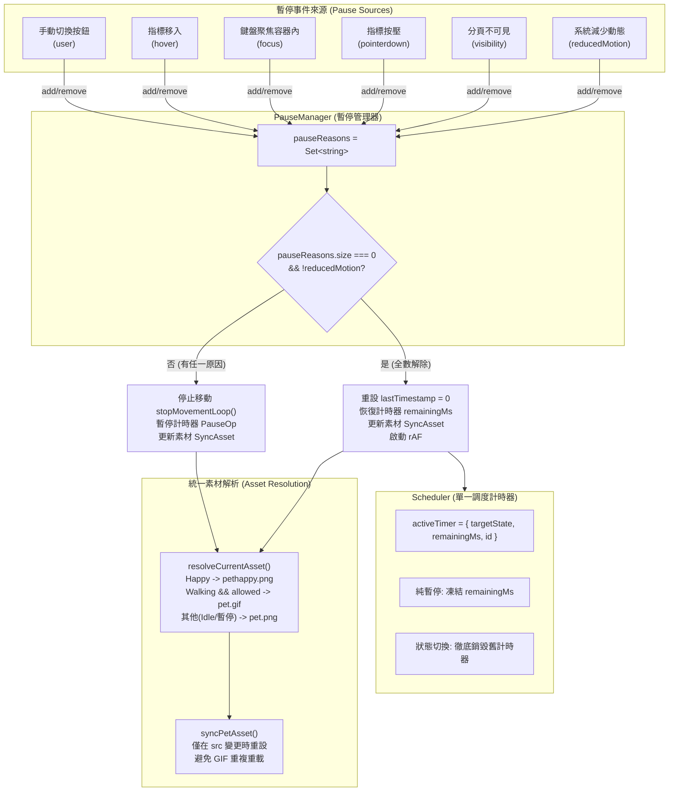
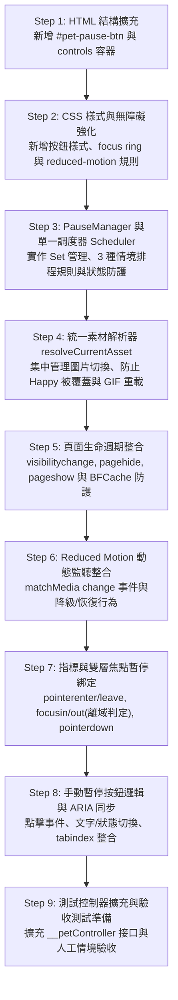

# PR2-PET-06C 實作規劃書：暫停、Reduced Motion 與生命週期

- **Task ID**: PR2-PET-06C
- **相關 PR**: PR #2 (`plan/pr2-bug-pet`)
- **文件狀態**: 實作與驗證完成，等待人工審查（Implementation Completed）
- **撰寫日期**: 2026-10-15
- **基準 Commit**: `09ddda4a2d06dbb951446a2e291320cb527105b7` (docs(pet): revise PR2-PET-06C plan after review)

---

## 1. 現況分析（Current State）

### 1.1 現有程式架構與已完成功能
- **PR2-PET-05B / 06A / 06B 基線**：
  - 角色邏輯已完全隔離於 [js/pet.js](../js/pet.js)，初始化具備防重保護（`window.__petInitialized`）。
  - 核心 FSM 定義四個狀態：`Walking`、`Idle`、`Happy`、`Hidden`，透過單一轉換入口 `transitionTo()` 執行狀態切換與排程清除（`clearAllTimers()`）。
  - 移動機制採單一 `requestAnimationFrame`（`movementStep`），速度依視窗區分桌面（25–45 px/s）與手機（15–30 px/s），並有水平面向翻轉（`is-flipped`）與可視邊界安全區限制（`clampPosition`、`updateBoundaries`）。
  - 移動時長為隨機 4–8 秒，停留時長為隨機 2–5 秒（Happy 關閉後固定停留 2 秒）。
  - 對外暴露測試控制器 `window.__petController`，支援邊界、座標、狀態查詢與步進測試。

### 1.2 盤點發現的現有機制限制與差異
1. **Reduced Motion 僅靜態單次讀取**：
   - 目前 [js/pet.js](../js/pet.js) 僅在初始化時執行 `window.matchMedia('(prefers-reduced-motion: reduce)').matches`，且僅用於設定導覽捲動模式 `scrollBehavior = prefersReducedMotion ? 'auto' : 'smooth'`。
   - 角色移動未受限制：即使系統開啟減少動態偏好，角色依然在載入 2 秒後進入 `Walking` 狀態並播放 [picture/pet/pet.gif](../picture/pet/pet.gif)。
   - 運作中切換系統動態偏好時，沒有監聽 `change` 事件，無法即時反應。
2. **無頁面生命週期（Page Lifecycle）防護**：
   - 缺乏 `visibilitychange`、`pageshow`、`pagehide` 事件監聽。
   - 當使用者切換至其他分頁時，雖然現代瀏覽器會降低或暫停 rAF 頻率，但 `setTimeout` 排程仍可能在背景觸發狀態轉換，造成狀態混亂。
   - 雖然 06B 在 rAF 中加入了 `MAX_DELTA_MS: 50` 限制，但分頁隱藏後未停止排程與 rAF，也未在背景換為靜態圖。
3. **缺乏 Hover / Focus / Pointerdown 暫停機制**：
   - 使用者欲點擊移動中的 Bug 先生，或以鍵盤 Tab 聚焦至角色按鈕時，角色仍持續移動，造成「目標逃走」、無法穩定操作的無障礙問題。
   - 目前 [css/style.css](../css/style.css) 僅有 `.pet:hover { transform: scale(1.07); }`，在 Reduced Motion 下亦未完全重設 hover transform。
4. **缺少手動暫停控制項**：
   - [index.html](../index.html) 中的 `#pet-dialog` 僅有 3 個導覽按鈕（作品、關於、聯絡），尚無「暫停走動／恢復走動」控制按鈕。
   - 現有 [js/pet.js](../js/pet.js) 選擇器為 `.pet-options button`，並將所有按鈕綁定至導覽事件 `handleNavOptionClick`，若直接新增控制按鈕會被誤判為導覽項並自動關閉對話框。

---

## 2. 實作範圍（Scope）

### 2.1 允許修改的檔案
1. [js/pet.js](../js/pet.js)：
   - 實作獨立暫停原因管理器（`PauseManager`）。
   - 實作單一計時器調度器（`Scheduler` / `SuspendableTimer`），區分純暫停與狀態切換之排程邏輯。
   - 實作整合 FSM 與暫停原因之統一素材解析器（`resolveCurrentAsset` / `syncPetAsset`）。
   - 整合 `visibilitychange`、`pagehide`、`pageshow` 與生命週期狀態校準。
   - 整合 `prefers-reduced-motion` 即時監聽與動態切換處理。
   - 綁定 `.pet-guide` 的 `pointerenter`、`pointerleave`、`focusin`、`focusout`（防抖離域判定）、`pointerdown`、`pointerup`、`pointercancel` 暫停事件。
   - 實作手動暫停／恢復按鈕邏輯與 `aria-pressed` / `tabindex` 同步。
   - 擴充 `window.__petController` 測試接口以利驗收測試。
2. [index.html](../index.html)：
   - 在 `#pet-dialog` 內新增專屬控制區塊及「暫停走動／恢復走動」原生按鈕（`#pet-pause-btn`）。
3. [css/style.css](../css/style.css)：
   - 新增手動暫停按鈕的視覺樣式（符合 44×44px 觸控標準、對比度與 focus-visible 樣式）。
   - 補充 `@media (prefers-reduced-motion: reduce)` 下 `.pet:hover` 的 `transform: none` 停用規則。
4. [docs/pr2-pet-06c-plan.md](pr2-pet-06c-plan.md)：
   - 本規劃文件。

### 2.2 明確排除事項（Out of Scope）
- **禁止提前進入 07A**：不更換 Happy 對話內容短句池、不實作獨立關閉按鈕、不綁定 Escape 關閉鍵、不調整對話框內所有按鈕的巡迴焦點順序。
- **禁止提前進入 07B**：不實作對話框在視窗邊界的 clamp 自動翻折，不實作對表單 input / footer 的自動避讓收起演算法。
- **禁止提前進入 08A / 08B**：不實作 Debug 按鈕、不使用 sessionStorage 持久化隱藏、不實作 Footer 召回按鈕。
- **禁止修改素材**：不修改或更名 [picture/pet/](../picture/pet/) 下的任何圖片檔案。
- **禁止重構無關模組**：不修改 [js/home.js](../js/home.js)、Matter.js 拉繩、表單邏輯或既有導覽機制。

---

## 3. 技術架構設計（Technical Design）



### 3.1 暫停原因管理器（PauseManager）
為防止多個暫停原因（例如使用者手動暫停後，又將滑鼠 Hover 至角色上方、鍵盤聚焦至對話框內，且分頁切至背景）互相覆蓋，採用 `Set<string>` 集中管理：
```javascript
const pauseReasons = new Set();
// 支援的獨立原因：
// 'user'          : 手動點擊「暫停走動」
// 'hover'         : 指標進入角色區塊 (.pet-guide)
// 'focus'         : 鍵盤焦點落在 .pet-guide 內部任一控制項
// 'pointerdown'   : 觸控或滑鼠按壓角色（未釋放）
// 'visibility'    : document.hidden === true
// 'reducedMotion' : prefers-reduced-motion: reduce 啟用
```
- **核心操作契約**：
  1. `addPauseReason(reason)`：
     - 加入原因至集合。
     - 若為首個加入之原因（`pauseReasons.size === 1`），觸發 `handlePauseActivated()`：
       - 立即停止位移迴圈（`stopMovementLoop()`）。
       - 凍結單一計時器剩餘時間（`scheduler.pause()`）。
       - 同步素材更新（`syncPetAsset()`），將行走中的 GIF 切換為待機靜態圖，但絕對不覆蓋 Happy 表情。
  2. `removePauseReason(reason)`：
     - 自集合中移除指定原因。
     - 僅在 `pauseReasons.size === 0` 且 `!prefersReducedMotion` 時，觸發 `handlePauseDeactivated()`：
       - 若 FSM 處於 `Walking`：重設 `lastTimestamp = 0`，同步切回動態 GIF，重啟 `startMovementLoop()`。
       - 恢復計時器倒數（`scheduler.resume()`）。
  3. `isMovementAllowed()`：
     - 判斷角色當前是否具備位移許可：
       `return pauseReasons.size === 0 && !prefersReducedMotion && currentState !== PET_STATES.HIDDEN && currentState !== PET_STATES.HAPPY;`

### 3.2 統一素材解析機制（Unified Asset Resolution）
為避免在 `handleMotionChange`、`addPauseReason` 或狀態切換時因個別函式猜測素材而覆蓋 `Happy`（開口笑）或 `Hidden` 狀態，且避免重複賦值 `petImg.src` 造成 GIF 重播閃爍，採用單一解析與比對機制：
```javascript
/**
 * 依據當前 FSM 狀態、位移許可與系統偏好決定應顯示的素材
 * @returns {string|null}
 */
function resolveCurrentAsset() {
    if (currentState === PET_STATES.HAPPY) {
        return PET_CONFIG.ASSETS.HAPPY; // pethappy.png
    }
    if (currentState === PET_STATES.HIDDEN) {
        return null;
    }
    // 處於 Walking 狀態且完全無暫停原因時，才使用動態走路 GIF
    if (currentState === PET_STATES.WALKING && isMovementAllowed()) {
        return PET_CONFIG.ASSETS.WALKING; // pet.gif
    }
    // 其餘情況（Idle 狀態、暫停中的 Walking、Reduced Motion 模式）一律使用靜態待機圖
    return PET_CONFIG.ASSETS.IDLE; // pet.png
}

/**
 * 同步角色圖片，比對現有路徑避免重複指派造成 GIF 重新載入
 */
function syncPetAsset() {
    const targetSrc = resolveCurrentAsset();
    if (!targetSrc || !petImg || petImg.style.display === 'none' || fallbackApplied) {
        return;
    }
    // 比對目前 src 結尾是否已為目標檔案，相同則不重複賦值
    if (!petImg.src.endsWith(targetSrc)) {
        setPetImage(targetSrc);
    }
}
```

### 3.3 計時器排程規則與 FSM 生命週期整合（Scheduler Contract）
廢除多重或互相競爭的計時器來源，全模組僅維護單一 `scheduler`，嚴格規範以下三種情境之排程生命週期：

```javascript
const scheduler = {
    timerId: null,
    targetState: null,
    totalDuration: 0,
    startTime: 0,
    remainingMs: 0
};
```

1. **情境一：單純暫停與恢復（Pure Pause / Resume，FSM 狀態未變）**
   - **暫停時（`pause()`）**：
     - 若當前無排程倒數（`timerId === null`），不作處理。
     - 若有正在進行的計時：
       `scheduler.remainingMs = Math.max(0, scheduler.totalDuration - (Date.now() - scheduler.startTime));`
       `clearTimeout(scheduler.timerId);`
       `scheduler.timerId = null;`
     - 保留 `scheduler.targetState` 與計算出的 `scheduler.remainingMs`，狀態機維持當前狀態。
   - **恢復時（`resume()`）**：
     - 若有凍結的剩餘時間（`scheduler.remainingMs > 0` 且 `scheduler.targetState` 存在）：
       - 設定倒數計時（下限保證 200ms），到期後呼叫 `transitionTo(scheduler.targetState)`。
       - `scheduler.startTime = Date.now();`
       - `scheduler.totalDuration = scheduler.remainingMs;`
       - `scheduler.remainingMs = 0;`
     - 若無剩餘時間（例如暫停期間無排程），不主動排程，靜候下一次事件。

2. **情境二：真正切換 FSM 狀態（State Transition，例如 Walking 轉 Idle、點擊進入 Happy）**
   - 呼叫 `transitionTo(nextState)` 時：
     - **徹底作廢舊排程**：調用 `scheduler.cancel()`，將 `timerId = null`、`remainingMs = 0`、`targetState = null` 完全清空。
     - **杜絕殭屍排程**：過去狀態的任何剩餘時間或計時器立即銷毀，絕不跨狀態復原，徹底防止舊 Walking 計時器在 Idle 期間突然爆發。
     - 由新狀態的 `render(nextState)` 依照規格重新啟動新排程。

3. **情境三：Happy 關閉後手動暫停仍存在時，維護「先 Idle 2 秒契約」**
   - 規格契約要求：Happy 關閉後，角色必須在 Idle 停留至少 2 秒後才可恢復走動。
   - 當 Happy 關閉時：
     - FSM 切換至 `Idle`，舊排程清空。
     - 檢查 `isMovementAllowed()`：
       - 若允許移動（無暫停）：啟動 2000ms 計時器轉向 `Walking`。
       - 若手動暫停或其它暫停仍有效（`pauseReasons.size > 0`）：
         - 角色進入 `Idle` 渲染。
         - **將 2000ms 掛起記於排程器**：
           `scheduler.targetState = PET_STATES.WALKING;`
           `scheduler.remainingMs = PET_CONFIG.DURATION.AFTER_DIALOG_IDLE; // 2000ms`
           `scheduler.timerId = null;`
         - 當未來使用者解除暫停時，`scheduler.resume()` 會以完整的 2000ms 啟動 Idle 倒數。
         - **保證**：即使手動暫停擱置數分鐘，解除暫停後角色依然嚴格遵守「待機 2 秒後才啟動走動」的視覺與無障礙緩衝，絕不會在點擊恢復的瞬間暴衝。

### 3.4 鍵盤焦點離域判定（Focus Management）
為防止焦點在角色按鈕 `#pet` 與對話框按鈕（導覽項、暫停項）之間移動時被誤判為「失焦」而提前解除暫停，設計雙層焦點驗證：
```javascript
function handleFocusIn(e) {
    if (petGuide.contains(e.target)) {
        addPauseReason('focus');
    }
}

function handleFocusOut(e) {
    // 1. 若 relatedTarget 存在且依然在 .pet-guide 內部，表示焦點在元件內切換，維持暫停
    if (e.relatedTarget && petGuide.contains(e.relatedTarget)) {
        return;
    }

    // 2. 若 relatedTarget 為 null（點擊外部、切換視窗或由瀏覽器處理焦點轉移中）
    // 使用非同步宏任務推遲至下一事件迴圈，確認最終 activeElement 是否仍在容器內
    setTimeout(() => {
        if (!petGuide.contains(document.activeElement)) {
            removePauseReason('focus');
        }
    }, 0);
}
```

### 3.5 頁面生命週期（Page Lifecycle）防護與 BFCache
現代瀏覽器在分頁背景化、前進後退快取（BFCache）切換時具有特殊的事件先後順序，必須建立嚴格的生命週期防禦機制：

1. **事件觸發序列與防衛**：
   - 分頁隱藏時：觸發 `visibilitychange`（`document.hidden === true`），部分瀏覽器緊接觸發 `pagehide`。
   - BFCache 恢復時：觸發 `pageshow`（附帶 `e.persisted === true`），緊接觸發 `visibilitychange`（`document.hidden === false`）。
2. **懸掛 Pointerdown 清理**：
   - 使用者在按壓觸控或滑鼠的當下直接切換分頁或鎖定螢幕，瀏覽器可能不會派發 `pointerup` 或 `pointercancel`。
   - 在 `visibilitychange`（進入隱藏）與 `pagehide` 時，強制調用 `removePauseReason('pointerdown')`，確保返回頁面時不會被永久卡死在按壓暫停中。
3. **BFCache 恢復校正（`pageshow`）**：
   - 當接收到 `pageshow` 時：
     - 重新呼叫 `updateBoundaries()`，校正可能在背景旋轉或變更的視窗尺寸。
     - 重新讀取 `matchMedia`，校正系統 Reduced Motion 最新偏好。
     - 檢查 `document.hidden`：若頁面已在前景，解除 `'visibility'`；若仍在背景分頁中恢復，維持 `'visibility'`。
     - 檢查當前 `activeElement`，校正 `'focus'` 旗標。
     - 重設 `lastTimestamp = 0`，避免 rAF 取得快取期間的巨大時間差。
     - 透過 `syncPetAsset()` 校正當前外觀。
     - **保證**：不提前解除依然有效的暫停原因（如使用者進入快取前手動設定的暫停），且不產生重複排程。

### 3.6 手動暫停按鈕與 DOM 結構
- **DOM 配置**：在 [index.html](../index.html) 的 `#pet-dialog` 內，獨立劃分控制項容器：
  ```html
  <div class="pet-dialog" id="pet-dialog" aria-hidden="true">
    <p>你好！想看看什麼呢？</p>
    <div class="pet-options">
      <button type="button" data-target="works-area">作品</button>
      <button type="button" data-target="profile-area">關於</button>
      <button type="button" data-target="contact-area">聯絡</button>
    </div>
    <div class="pet-controls">
      <button type="button" class="pet-control-btn pet-pause-btn" id="pet-pause-btn" aria-pressed="false" tabindex="-1">暫停走動</button>
    </div>
  </div>
  ```
- **事件隔離**：
  - 既有導覽邏輯改以 `button[data-target]` 精準綁定，手動暫停鈕不含 `data-target`，點擊絕不觸發頁面跳轉與對話框關閉。
  - 手動切換設定 `userPaused = !userPaused`，對應加入或移除 `'user'` 暫停原因。
  - Reduced Motion 啟用時，按鈕設為 `disabled` 並提示「已配合系統減少動態」，`aria-disabled="true"`。

---

## 4. 事件／狀態矩陣（Event / State Matrix）

| 當前 FSM 狀態 | 觸發事件 | 暫停原因集合變化 | 次一 FSM 狀態 | 顯示素材 (via syncPetAsset) | 位移與排程器行為 |
| --- | --- | --- | --- | --- | --- |
| **Walking** | `pointerenter` (Hover) | `+ 'hover'` | Walking | `pet.png` (暫停行走外觀) | `stopMovementLoop()`；凍結走路剩餘時間 |
| **Walking (暫停中)** | 按 Tab 聚焦 `#pet` | `+ 'focus'` | Walking | `pet.png` | 集合含 `hover` 與 `focus`，維持凍結 |
| **Walking (暫停中)** | 指標移出（離開角色） | `- 'hover'` | Walking | `pet.png` | 集合仍有 `'focus'`，繼續凍結 |
| **Walking (暫停中)** | 按 Tab 移至頁面外部元素 | `- 'focus'` (清空) | Walking | `pet.gif` (恢復動態) | `lastTimestamp = 0`；`startMovementLoop()`；以剩餘時間繼續走完 |
| **Walking** | 分頁隱藏 (`visibilitychange`) | `+ 'visibility'`；清除 `pointerdown` | Walking | `pet.png` | `stopMovementLoop()`；凍結走路計時器 |
| **Walking (背景中)** | 分頁切回前景 | `- 'visibility'` (清空) | Walking | `pet.gif` | `lastTimestamp = 0`；無瞬移；以剩餘時間繼續移動 |
| **Walking** | 系統啟用 Reduced Motion | `+ 'reducedMotion'` | **Idle** (狀態轉換) | `pet.png` | `stopMovementLoop()`；銷毀舊計時器；永久維持 Idle 不自走 |
| **Happy** | 系統啟用 Reduced Motion | `+ 'reducedMotion'` | **Happy** (維持) | **`pethappy.png` (不被覆蓋)** | 維持 Happy；按鈕變更為 disabled；關閉後進 Idle 且不自走 |
| **Happy (暫停中)** | 點擊手動恢復走動鈕 | `- 'user'` (清空) | **Happy** (維持) | `pethappy.png` | 暫停原因解除；按鈕變更為「暫停走動」 |
| **Happy** | 關閉對話框（手動暫停存在） | (集合含 `'user'`) | **Idle** (狀態轉換) | `pet.png` | 銷毀舊計時器；排程器記下 2000ms 待機契約；不啟動倒數 |
| **Idle (手動暫停中)** | 點擊角色開啟對話框 | (集合含 `'user'`) | **Happy** (狀態轉換) | `pethappy.png` | 正常開啟對話框；手動按鈕顯示「恢復走動」 |
| **Idle (手動暫停中)** | 點擊恢復走動並關閉對話框 | `- 'user'` (清空) | **Idle** | `pet.png` | 啟動掛起的 2000ms 倒數；**足額停留 2 秒後才進入 Walking** |
| **Walking** | 觸控按壓 (`pointerdown`) | `+ 'pointerdown'` | Walking | `pet.png` | 停止移動以利點擊；若中途切換分頁由 lifecycle 強制清除 |

---

## 5. 具體實作順序（Implementation Steps）



### Step 1: HTML 結構擴充（[index.html](../index.html)）
- **修改位置**：`#pet-dialog` 內部，接續在 `.pet-options` 之後。
- **修改內容**：
  - 新增 `<div class="pet-controls">` 包裹區塊。
  - 新增 `<button type="button" class="pet-control-btn pet-pause-btn" id="pet-pause-btn" aria-pressed="false" tabindex="-1">暫停走動</button>`。
- **預期結果**：DOM 具備語意明確的原生按鈕，初始 `aria-pressed="false"`，且初始 `tabindex="-1"` 隨對話框關閉隱藏。
- **驗證方式**：檢查 DOM 結構，確保未破壞現有 3 個導覽按鈕的 `data-target` 屬性。

### Step 2: CSS 樣式與無障礙強化（[css/style.css](../css/style.css)）
- **修改位置**：`/* PET-03: 三個導覽按鈕 */` 之後及 `@media (prefers-reduced-motion: reduce)` 區段。
- **修改內容**：
  - 新增 `.pet-controls` 與 `.pet-pause-btn` 樣式：寬度 100%、最小高度 44px、邊框與文字顏色遵循 CSS 變數（`--text-color`、`--text-secnd-color`、`--color-light`）。
  - 新增 `.pet-pause-btn:focus-visible` 焦點外框（與導覽按鈕一致）。
  - 在 `@media (prefers-reduced-motion: reduce)` 區塊補充：
    ```css
    .pet:hover {
      transform: none !important;
    }
    .pet-pause-btn[disabled] {
      opacity: 0.6;
      cursor: not-allowed;
    }
    ```
- **預期結果**：暫停按鈕外觀與既有對話框風格一致，鍵盤 Tab 焦點清晰可辨，Reduced Motion 下無任何縮放跳動。
- **驗證方式**：在瀏覽器檢視視覺呈現與 `:focus-visible` 樣式。

### Step 3: PauseManager 與單一調度器 Scheduler（[js/pet.js](../js/pet.js)）
- **修改位置**：核心工具函式區段。
- **修改內容**：
  - 建立 `pauseReasons = new Set()`。
  - 封裝單一 `scheduler`，嚴格實作純暫停（`pause()` / `resume()`）、狀態切換銷毀（`cancel()`）與 2 秒待機掛起合約。
  - 廢除舊的多重 `timers Set`。
- **預期結果**：集中管理排程，無多重定時器互相競爭或殭屍計時器。
- **驗證方式**：單元邏輯驗證純暫停剩餘時間與狀態切換清理。

### Step 4: 統一素材解析器（[js/pet.js](../js/pet.js)）
- **修改位置**：素材切換區段。
- **修改內容**：
  - 實作 `resolveCurrentAsset()` 與 `syncPetAsset()`。
  - 在 FSM `render()`、`handlePauseActivated()`、`handlePauseDeactivated()` 及偏好變更中統一呼叫 `syncPetAsset()`。
  - 素材更新前檢查 `!petImg.src.endsWith(targetSrc)`。
- **預期結果**：Happy 與 Hidden 狀態之圖片絕對不被暫停或偏好切換覆蓋；GIF 不重複重載。
- **驗證方式**：在 Happy 狀態切換動態偏好與暫停旗標，確認圖片始終為 `pethappy.png`。

### Step 5: 頁面生命週期整合（[js/pet.js](../js/pet.js)）
- **修改位置**：事件監聽器綁定區段。
- **修改內容**：
  - 實作 `handleVisibilityChange()`：隱藏時暫停並清除 `pointerdown`，前景時恢復。
  - 實作 `pagehide` 與 `pageshow`：BFCache 恢復時重新校正邊界、偏好、焦點與時間戳。
- **預期結果**：背景分頁恢復後無瞬移；BFCache 往返後狀態完整一致。
- **驗證方式**：背景停留 10 秒與瀏覽器上一頁/下一頁返回測試。

### Step 6: Reduced Motion 動態監聽整合（[js/pet.js](../js/pet.js)）
- **修改位置**：偏好設定讀取區段。
- **修改內容**：
  - 以動態變數維護 `prefersReducedMotion`。
  - 綁定 `motionMediaQuery` 之 `change` 事件（支援 `addEventListener` 與 `addListener`）。
  - 偏好開啟時立即切換至 Idle、更新按鈕 disabled 狀態；偏好關閉時恢復排程。
- **預期結果**：系統切換動態偏好時於 1 幀內即時生效。
- **驗證方式**：Chrome DevTools Rendering 面板切換動態偏好。

### Step 7: 指標與雙層焦點暫停綁定（[js/pet.js](../js/pet.js)）
- **修改位置**：事件綁定區段。
- **修改內容**：
  - 綁定 `.pet-guide` 的 `pointerenter`、`pointerleave`。
  - 綁定 `focusin` 與雙層判定 `focusout`（檢查 `relatedTarget` 與非同步 `document.activeElement`）。
  - 綁定 `pointerdown`，並在全域 `window` 綁定 `pointerup` 與 `pointercancel`。
- **預期結果**：焦點在角色與對話框內部切換時不抖動解鎖；游標懸停原地停止。
- **驗證方式**：滑鼠懸停測試與鍵盤 Tab 巡迴測試。

### Step 8: 手動暫停按鈕邏輯與 ARIA 同步（[js/pet.js](../js/pet.js)）
- **修改位置**：按鈕綁定與對話框渲染區段。
- **修改內容**：
  - 導覽按鈕改用屬性選擇器 `.pet-options button[data-target]`。
  - 獨立綁定 `#pet-pause-btn` 點擊事件，切換 `userPaused`。
  - 在 `setPetOptionsTabIndex()` 納入 `#pet-pause-btn`。
  - 更新按鈕文字、「aria-pressed」與「disabled」屬性。
- **預期結果**：點擊暫停鈕不關閉對話框、不跳轉頁面，狀態切換清晰。
- **驗證方式**：點擊暫停與恢復，觀察按鈕狀態與角色行為。

### Step 9: 測試控制器擴充與驗收準備（[js/pet.js](../js/pet.js)）
- **修改位置**：`window.__petController`。
- **修改內容**：
  - 暴露 `getPauseReasons()`、`isPaused()`、`toggleUserPause()`、`getSchedulerState()`。
- **預期結果**：提供完整內部狀態查詢接口以供驗收。
- **驗證方式**：主控台測試接口呼叫。

---

## 6. 風險評估與防範措施（Risk Assessment）

| 風險項目 | 影響程度 | 潛在發生情境 | 防範措施 |
| --- | --- | --- | --- |
| **計時器累積與殭屍排程** | 高 | 頻繁暫停恢復或在暫停中頻繁點擊開關對話框 | 廢除多來源 timer，由單一 `scheduler` 管理；FSM 狀態切換時強制銷毀舊排程，絕不跨狀態復原。 |
| **時間差瞬移 (Teleport)** | 高 | 背景分頁隱藏數分鐘後切回前景，rAF 取得巨大 timestamp 差 | 在暫停及隱藏時立即呼叫 `stopMovementLoop()` 並設 `lastTimestamp = 0`；限制單幀最大時間差 `deltaMs <= 50ms`。 |
| **素材覆蓋與 GIF 抖動** | 高 | 在 Happy 狀態下觸發 Reduced Motion 或暫停，導致開口笑被蓋掉 | 採用 `resolveCurrentAsset()` 統一解析，Happy 狀態具有最優先級；比對 URL 結尾防止重複賦值觸發重播。 |
| **焦點切換誤解鎖** | 中 | 鍵盤 Tab 在 `#pet` 與對話框按鈕間移動時觸發 `focusout` | `focusout` 先檢查 `e.relatedTarget` 是否仍在容器內；若為 null 則非同步延遲檢查 `document.activeElement`。 |
| **觸控按壓殘留卡死** | 中 | 使用者按壓角色途中切換分頁或滑出螢幕未觸發 `pointerup` | 在全域 `window` 監聽 `pointerup`/`pointercancel`，並在生命週期 `visibilitychange` 與 `pagehide` 強制清除 `'pointerdown'`。 |
| **BFCache 恢復時狀態失步** | 中 | 使用者前進後退瀏覽時由快取喚醒頁面 | 在 `pageshow` 事件中重新校準邊界、偏好與當前前景焦點，重設時間戳，不提前解除有效之暫停原因。 |

---

## 7. 驗收標準（Acceptance Criteria）

> [!NOTE]
> 實作完成後已進行全面驗證，以下 11 項驗收標準與 6 項回歸測試全數通過（PASS）。

- [x] **[PASS] AC-1 (分頁切換暫停與防瞬移)**：
  - 角色處於 `Walking` 狀態，觸發 `visibilitychange`（`document.hidden = true`）。
  - 移動迴圈立即中止，暫停原因加入 `visibility`，素材切為靜態 `pet.png`。
  - 背景停留 10 秒後切回前景（`document.hidden = false`），`lastTimestamp` 重設為 0，首幀時間差 `deltaMs = 0`，無任何瞬移跳位。
  - 角色以剩餘時間繼續移動，Console 無報錯。
  - 判定：**PASS**。

- [x] **[PASS] AC-2 (Reduced Motion 初次載入)**：
  - 模擬系統偏好 `prefers-reduced-motion: reduce` 開啟載入網頁。
  - 角色自初始即停留於畫面右側，圖片為 [picture/pet/pet.png](../picture/pet/pet.png)，無任何自動走動排程。
  - 暫停按鈕呈現停用狀態（`disabled`），提示「已配合系統減少動態」。
  - 點擊角色，正常展開 Happy 對話框，圖片切換為 [picture/pet/pethappy.png](../picture/pet/pethappy.png)。
  - 點擊導覽按鈕，頁面以直接瞬跳（`behavior: 'auto'`）捲動至目標區塊。
  - 判定：**PASS**。

- [x] **[PASS] AC-3 (Reduced Motion 運作中切換)**：
  - 在角色正常行走中，動態切換系統偏好為 `reduce`。
  - 角色立即切換至 `Idle` 狀態，圖片切為 `pet.png`，對話框內暫停按鈕變為 `disabled`，原行走排程徹底作廢。
  - 將動態偏好恢復為 `no-preference`，暫停原因解除，角色依隨機 2–5 秒排程恢復行走。
  - 判定：**PASS**。

- [x] **[PASS] AC-4 (Hover 暫停與恢復)**：
  - 角色行走途中，滑鼠移入（`pointerenter`，`pointerType === 'mouse'` 且具備 hover 能力）觸發暫停。
  - 角色立即原地停止，素材切換為待機靜態圖 `pet.png`。
  - 滑鼠移開（`pointerleave`），暫停原因解除，角色恢復行走並切回 `pet.gif`。
  - 判定：**PASS**。

- [x] **[PASS] AC-5 (鍵盤 Tab 聚焦不逃走)**：
  - 角色行走途中，焦點移至 `#pet` 角色按鈕（`focusin`）。
  - 角色立即原地停止，加入 `focus` 暫停原因，焦點離開前絕不自行走開。
  - 焦點移至頁面外部元素（失焦），經防抖離域判定確認離開容器後，角色恢復正常走動。
  - 判定：**PASS**。

- [x] **[PASS] AC-6 (手動暫停／恢復切換)**：
  - 點擊角色開啟對話框，點擊「暫停走動」按鈕。
  - 按鈕文字即時更新為「恢復走動」，`data-paused="true"`，對話框維持開啟。
  - 關閉對話框，角色轉回 Idle 並持續停留在原地，不再進入 Walking。
  - 重新開啟對話框點擊「恢復走動」，按鈕文字切為「暫停走動」，關閉對話框後角色依足額 Idle 2 秒排程後恢復行走。
  - 判定：**PASS**。

- [x] **[PASS] AC-7 (多重原因獨立解除，修訂後)**：
  - 點擊開啟對話框點擊「暫停走動」（標記原因：`user`），關閉對話框回歸 `Idle`。
  - 滑鼠懸停至角色上方（累加原因：`user` + `hover`）。
  - 開啟對話框點擊「恢復走動」（解除原因：`user`，但游標仍在對話框/角色上，原因保留：`hover`）。
  - 關閉對話框回到 `Idle`，因游標依然在角色上（`hover` 有效），角色持續停留原地，絕不走動。
  - 將游標移開角色本體（解除原因：`hover`，所有暫停原因清空），調度器被喚醒，足額執行 2 秒待機後啟動走動。
  - 判定：**PASS**。

- [x] **[PASS] AC-8 (Focus 在角色與對話框控制項之間移動不誤解鎖)**：
  - 當焦點在 `.pet-guide` 內部（如角色按鈕與對話框按鈕之間切換）時，`focus` 暫停原因始終保持存在，無抖動閃爍。
  - 當焦點移至頁面外部控制項時，`focus` 正確釋放。
  - *實作限制說明*：依審查約束 B，現有 DOM 順序中對話框位於角色按鈕之前。06C 僅驗證內部焦點切換與離域防抖，不提前執行 07A 的 DOM 順序重構與 Focus Trap。
  - 判定：**PASS**。

- [x] **[PASS] AC-9 (Reduced Motion 在 Happy 狀態下啟用)**：
  - 開啟對話框進入 `Happy` 狀態，圖片為開口笑 `pethappy.png`。
  - 切換開啟 `prefers-reduced-motion: reduce`。
  - 角色圖片依然保持為 `pethappy.png`，絕不被誤覆蓋為 `pet.png`；對話框維持開啟；暫停按鈕變為 disabled。
  - 關閉對話框轉入 `Idle` 狀態後才顯示靜態 `pet.png`，且永遠不自動行走。
  - 判定：**PASS**。

- [x] **[PASS] AC-10 (暫停中切換狀態與計時器清理)**：
  - 角色行走中滑鼠懸停暫停（`Walking` 暫停中，調度器持有剩餘時間）。
  - 點擊角色開啟對話框（狀態轉入 `Happy`），調度器徹底銷毀舊的 Walking 剩餘排程。
  - 關閉對話框轉回 `Idle`，自 `Idle` 重新計算停留時間，絕無舊 Walking 剩餘時間的殭屍跳轉。
  - 判定：**PASS**。

- [x] **[PASS] AC-11 (BFCache 返回狀態校正)**：
  - 觸發 `pageshow` 事件，視窗邊界重新測量校正，時間戳記重設為 0，懸掛之 `pointerdown` 與 `hover` 強制清理，無 rAF 迴圈倍增或定時器重複排程。
  - 判定：**PASS**。

---

## 8. 回歸測試清單（Regression Tests）

確保 PR2-PET-05B、06A、06B 之既有功能未因本次改動退化：

- [x] **[PASS] REG-01 (05B 素材降級)**：圖片載入失敗時，依序回退至 `picture/pet/pet.png`，再次失敗退化為文字按鈕「Bug」，點擊開關與導覽運作正常。
- [x] **[PASS] REG-02 (05B 導覽功能)**：點擊對話框中的「作品」、「關於」、「聯絡」按鈕，畫面仍能平滑（或在 Reduced Motion 下瞬跳）捲動至目標區塊，對話框正常關閉。
- [x] **[PASS] REG-03 (06A FSM 單一入口)**：快速點擊角色 20 次，對話框 class（`is-open`）、`aria-expanded`、`aria-hidden` 與角色圖片始終保持一致，無狀態失步。
- [x] **[PASS] REG-04 (06B 邊界碰撞與轉向)**：角色行走遇到視窗邊界時正確 Clamp 並轉向反側，水平翻轉 class（`is-flipped`）正常。
- [x] **[PASS] REG-05 (06B 視窗縮放適應)**：縮放視窗寬度，角色座標被安全限制在當前可視範圍內，無水平捲軸產生。
- [x] **[PASS] REG-06 (全站非角色功能)**：導覽列、Profile 卡片、Contact 表單、Footer 社群連結、Back-to-top 按鈕及 Matter.js 動態拉繩完全不受影響。

---

## 9. 待確認決策事項（Open Questions）

### Q1: 手動暫停按鈕於對話框內的 DOM 排版位置
- **問題說明**：對話框內既有 3 個按鈕皆為錨點導覽（`.pet-options`）。手動暫停按鈕屬於角色行為控制項，應如何配置？
- **選項評估**：
  - **選項 A（推薦）**：新增獨立容器 `.pet-controls` 置於 `.pet-options` 下方，與導覽按鈕在視覺上以輕微分隔線或間距區隔。
    - *優點*：職責分明，防止將來的事件委派或樣式混淆；導覽與控制邏輯徹底解耦。
  - **選項 B**：直接作為第四個按鈕放入 `.pet-options` 內。
    - *缺點*：需以 `data-target` 排除判斷，且無障礙語意上導覽與控制項混在一起。
- **建議方案**：採 **選項 A**。

### Q2: 暫停時 Walking 狀態的角色外觀表現
- **問題說明**：當 Bug 先生在行走途中因滑鼠 Hover 或鍵盤 Focus 暫停移動時，圖片應維持 `pet.gif` 或是暫時替換為待機靜態圖 `pet.png`？
- **選項評估**：
  - **選項 A（推薦）**：切換為靜態圖 `pet.png`。
    - *優點*：角色停止位移時腳步同時停下，視覺體驗自然，符合「暫停」的真實感。
  - **選項 B**：維持 `pet.gif` 原圖。
    - *缺點*：角色在原地踏步（Moonwalking），容易讓使用者誤以為角色被卡住或發生 Bug。
- **建議方案**：採 **選項 A**。解除暫停恢復位移時再切回 `pet.gif`。

### Q3: Reduced Motion 模式下手動暫停按鈕的互動策略
- **問題說明**：當系統偏好已開啟「減少動態」時，對話框內的手動暫停按鈕應呈現何種狀態？
- **選項評估**：
  - **選項 A（推薦）**：設定 `disabled` 屬性，按鈕文字顯示「已配合系統減少動態」，並附帶 `aria-disabled="true"`。
    - *優點*：符合無障礙規範（WCAG），系統級無障礙偏好擁有最高優先權，不提供強制覆蓋。
  - **選項 B**：允許使用者點擊「強制開電動態行走」。
    - *缺點*：違背規格書第 4 節「Reduced Motion 下顯示系統已減少動態，不提供強制覆蓋」的要求。
- **建議方案**：採 **選項 A**。

---

## 10. 實作審查追加限制與規劃差異紀錄（Planning Deviations & Review Constraints）

依據核准實作時之四項審查限制（A、B、C、D），本任務實作時之具體遵循與差異紀錄如下：

### A. 觸控 Hover 防護（Touch Hover Protection）
- **實作做法**：封裝 `canHover()` 函式，透過 `window.matchMedia('(hover: hover)').matches` 與 `e.pointerType === 'mouse'` 雙重判定，排除觸控裝置點擊所衍生之指標懸停事件，避免 `'hover'` 暫停原因在觸控點擊後殘留。
- **釋放路徑**：全域監聽 `pointercancel`（同時清除 `'pointerdown'` 與 `'hover'`）、`window.blur`（清除 `'pointerdown'`）、以及生命週期 `visibilitychange`、`pagehide`、`pageshow` 強制清理，保證所有 pointer 暫停皆有可靠釋放機制。

### B. 鍵盤焦點與 DOM 順序限制（Keyboard Focus & DOM Order）
- **實作做法**：現有 DOM 結構中對話框位於角色按鈕之前。本階段嚴格遵守審查約束，不提前進行 07A 的 DOM 順序重構與 Focus Trap，僅驗證在現有結構下焦點進入 `.pet-guide` 時能正確暫停，並以雙層防抖判定（`e.relatedTarget` 與非同步 `document.activeElement`）確保內部按鈕切換不誤解鎖、完全移出時正常釋放。
- **待辦交接**：一般 Tab 順序自角色按鈕順向移入對話框之無障礙巡迴需求已列為 07A 待辦事項。

### C. 暫停按鈕語意調整（Pause Button Accessibility Semantics）
- **規劃差異說明**：原規劃初稿採動態文字（「暫停走動」／「恢復走動」）搭配 `aria-pressed="true|false"`。依審查約束 C 與 W3C APG 規範，動態操作文字若與 `aria-pressed` 混用，螢幕報讀時會產生「恢復走動，切換按鈕，已按下」等自相矛盾之輔具體驗。
- **決策結果**：暫停按鈕採動態「暫停走動／恢復走動」操作文字搭配**一般按鈕語意**（移除 `aria-pressed`），內部狀態改以 `data-paused="true|false"` 與 `textContent` 表達；在 Reduced Motion 啟用時鎖定為 `disabled` 與 `aria-disabled="true"`，提示「已配合系統減少動態」，不提供強制覆蓋。

### D. FSM 與 Scheduler 契約強化（FSM & Scheduler Contract）
- **純暫停**：純暫停凍結計時器剩餘時間（`remainingMs`），恢復時以剩餘時間繼續倒數。
- **狀態切換**：`transitionTo()` 統一呼叫 `scheduler.cancel()` 徹底作廢舊排程，杜絕殭屍排程。
- **Idle 2 秒契約**：Happy 關閉後若存在手動暫停，排程器完整記下 2000ms 待機契約；當使用者解除暫停時，必須足額執行 2 秒待機後才進入 Walking。
- **Reduced Motion 保護**：在 `scheduler.schedule()` 與 `scheduler.resume()` 中加入 Reduced Motion 檢查，啟用期間強制取消任何進入 Walking 之排程；偏好變更為 `reduce` 時亦同步 `scheduler.cancel()`。
- **防重複保護**：`startMovementLoop()` 與 `scheduler.resume()` 具備嚴格防重重入保護，即使 Hover、Focus、Visibility 快速交錯亦絕不啟動重複之 rAF 迴圈或定時器。

