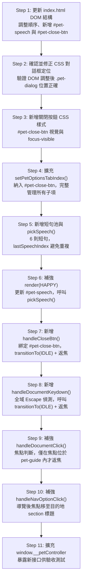

# PR2-PET-07A 實作規劃書：角色對話、關閉互動與焦點管理

- **Task ID**: PR2-PET-07A
- **相關 PR**: PR #2 (`plan/pr2-bug-pet`)
- **文件狀態**: 實作完成，等待人工驗收（Implementation Complete — AWAITING CODE REVIEW）
- **實作 Commit**: `01ac30b` (feat(pet): implement PR2-PET-07A dialog and focus behavior)
- **撰寫日期**: 2026-10-15
- **基準 Commit**: `56378a0` (fix(pet): address PR2-PET-06C review findings)
- **前置任務**: PR2-PET-06C（暫停、Reduced Motion 與生命週期）— 已通過人工複驗

---

## 1. Current State：現有架構盤點

### 1.1 DOM 現況（index.html）

```html
<!-- 現有 pet DOM 結構（實際 index.html 第 91–108 行） -->
<div class="pet-guide">
  <div class="pet-dialog" id="pet-dialog" aria-hidden="true">
    <p>你好！想看看什麼呢？</p>
    <div class="pet-options">
      <button data-target="works-area">作品</button>
      <button data-target="profile-area">關於</button>
      <button data-target="contact-area">聯絡</button>
    </div>
    <div class="pet-controls">
      <button type="button" class="pet-control-btn pet-pause-btn"
              id="pet-pause-btn" tabindex="-1">暫停走動</button>
    </div>
  </div>
  <button class="pet" id="pet"
          aria-label="開啟網站導覽"
          aria-controls="pet-dialog"
          aria-expanded="false">
    
  </button>
</div>
```

> [!IMPORTANT]
> **目前 DOM 順序問題（07A 核心挑戰）**：`#pet-dialog` 位於角色按鈕 `#pet` **之前**。
> 鍵盤使用者以 Tab 從 `#pet` 繼續往後，會跳到 `.back-to-top-wrapper`，
> 完全無法直接進入對話框內容，違反第5節規格要求。

### 1.2 現有 js/pet.js 已完成功能（06C 基線）

| 模組 / 功能 | 實作位置 | 狀態 |
| --- | --- | --- |
| 四狀態 FSM（Walking / Idle / Happy / Hidden） | `PET_STATES`, `transitionTo()`, `render()` | ✅ 已完成 |
| 單一轉換入口 | `transitionTo()` | ✅ 已完成 |
| PauseManager（Set 原因集合） | `pauseReasons`, `addPauseReason()`, `removePauseReason()` | ✅ 已完成 |
| 暫停原因：user / hover / focus / pointerdown / visibility / reducedMotion | 各 handler | ✅ 已完成 |
| Scheduler（凍結剩餘時間、純暫停 vs 狀態切換） | `scheduler` 物件 | ✅ 已完成 |
| Happy 關閉後 Idle 2 秒契約 | `render()` case IDLE + Scheduler | ✅ 已完成 |
| 統一素材解析 | `resolveCurrentAsset()`, `syncPetAsset()` | ✅ 已完成 |
| 雙層 focusin / focusout 防抖 | `handleFocusIn()`, `handleFocusOut()` | ✅ 已完成（基於現有 .pet-guide 含整個容器） |
| Tab 焦點進入 .pet-guide 暫停移動 | `handleFocusIn()` | ✅ 已完成 |
| 手動暫停按鈕（#pet-pause-btn） | `handlePauseToggle()`, `updatePauseButtonUI()`, `setPetOptionsTabIndex()` | ✅ 已完成 |
| 三個導覽按鈕 | `handleNavOptionClick()` | ✅ 已完成（已用 `button[data-target]` 精確選取） |
| Reduced Motion 動態監聽 | `handleMotionChange()` | ✅ 已完成 |
| 頁面生命週期（visibility / BFCache） | 多個 handler | ✅ 已完成 |
| rAF 移動迴圈 | `movementStep()`, `startMovementLoop()`, `stopMovementLoop()` | ✅ 已完成 |
| 素材失敗降級 | `showTextFallback()`, `setPetImage()` | ✅ 已完成 |
| 測試控制器 | `window.__petController` | ✅ 已完成 |

### 1.3 現有 CSS Pet 區段摘要（css/style.css 第 535 行以後）

| 規則 | 說明 |
| --- | --- |
| `.pet-guide` | `position: fixed; left: 0; bottom: clamp(16px, 3vw, 32px); z-index: 1000;` |
| `.pet` | `64px × 64px`，透明背景，`border-radius: 8px`，hover `scale(1.07)` |
| `.pet:focus-visible` | `outline: 3px solid #7c4dff` |
| `.pet-img` | `object-fit: contain`，`is-flipped` class 翻轉 |
| `.pet-dialog` | `position: absolute; bottom: calc(100% + 10px); right: 0` 隱藏時 `opacity:0; pointer-events:none; transform: translateY(6px)` |
| `.pet-dialog.is-open` | `opacity:1; pointer-events:auto; transform:translateY(0)` |
| `.pet-options button` | 導覽按鈕，`hover/focus-visible` 有樣式 |
| `.pet-control-btn` | 100% 寬，`min-height:44px` |
| `@media (prefers-reduced-motion: reduce)` | `transition: none` for pet / dialog / options / controls |

### 1.4 規劃文件與程式現況差異紀錄

> [!WARNING]
> 以下差異為實際盤點發現，須在 07A 規劃中明確處理，不得假設文件與現況一致。

| 差異項目 | 規劃文件（pr2-bug-pet-plan.md）說明 | 實際現況 | 07A 處理方式 |
| --- | --- | --- | --- |
| **D1: 對話框關閉按鈕** | 第5節明定需新增明確關閉按鈕 | 現有 DOM 與 JS 均無關閉按鈕 | 07A 新增 `#pet-close-btn` |
| **D2: Escape 關閉** | 第5節明定需支援 Escape | 現有無 Escape handler | 07A 新增 `keydown` handler |
| **D3: 短句池** | 第5節列出 6 則短句，開啟抽取避免重複 | 現有 `<p>你好！想看看什麼呢？</p>` 固定文字 | 07A 新增短句陣列與抽取邏輯 |
| **D4: DOM Tab 順序** | 第5節要求角色按鈕後可直接 Tab 進對話框 | `#pet-dialog` 在 DOM 排序上位於 `#pet` 之前，Tab 順序與視覺相反 | 07A 調整 DOM，將 `#pet-dialog` 移到 `#pet` 之後 |
| **D5: Happy 換圖** | 第3節明定 Happy 狀態應顯示 pethappy.png | `resolveCurrentAsset()` 已正確處理，但無對話內容聯動 | 已完成，07A 補強短句顯示即可 |
| **D6: 外部點擊焦點處理** | 第5節：外部點擊不搶走使用者正在操作之外部元素焦點 | `handleDocumentClick()` 現直接呼叫 `transitionTo(IDLE)`，未檢查焦點位置 | 07A 補強焦點判斷邏輯 |
| **D7: 導覽焦點落點** | 第5節要求導覽後焦點移到 section 或標題 | `handleNavOptionClick()` 現只 `scrollIntoView`，無焦點移轉 | 07A 補強焦點移轉至目的地標題/section |
| **D8: 暫停按鈕 DOM 位置** | 規劃書第5節提到新增關閉、Debug、暫停走動 | 06C 已實作暫停按鈕，置於 `.pet-controls` | 07A 繼承此結構，補充關閉按鈕位置 |
| **D9: inert/hidden 對面板子項管理** | 第5節要求關閉時用 hidden/inert 或完整控制所有可聚焦子項 | 現僅以 `tabindex=-1` 管理 `.pet-options button` 與 `#pet-pause-btn`，07A 新增關閉按鈕後需一併納入 | 07A 擴充 `setPetOptionsTabIndex()` 以管理所有子項 |

---

## 2. Scope / Out of Scope

### 2.1 允許修改的檔案

| 檔案 | 允許修改的範圍 |
| --- | --- |
| `index.html` | pet-guide DOM 結構：DOM 順序調整、新增關閉按鈕、更新 `<p>` 為帶 ID 的對話文字容器 |
| `js/pet.js` | 短句池陣列、抽取邏輯、關閉按鈕 handler、Escape handler、導覽焦點落點、外部點擊焦點判斷、`setPetOptionsTabIndex()` 擴充、`render()` 補強 |
| `css/style.css` | 關閉按鈕樣式，以及 DOM 順序調整後可能需要更新的對話框定位規則 |
| `docs/pr2-pet-07a-plan.md` | 本文件 |

### 2.2 明確排除事項（Out of Scope）

- **不提前實作 07B**：不實作對話框邊界 clamp 翻折、不實作對 `.nav`、`#myForm`、Footer 的空間避讓演算法。
- **不提前實作 08A**：不新增 Debug 按鈕，不使用 sessionStorage 持久化隱藏狀態。
- **不提前實作 08B**：不新增 Footer 召回按鈕。
- **不修改 Matter.js**：不觸碰 js/home.js 中的任何非 pet 程式。
- **不加 aria-modal 或 Focus Trap**：依規格書第5節，保持非模態展開面板，不使用不完整的 Modal 語意或焦點陷阱。
- **不新增音效**：不載入任何音訊素材或播放 UI。
- **不修改圖片素材**：不改動 picture/pet/ 下任何檔案。
- **不建立新 PR，不自行合併**。

---

## 3. DOM Design：修改前後 DOM 結構

### 3.1 現有 DOM 順序（Before）

```html
<div class="pet-guide">
  <!-- ⚠️ 對話框在角色按鈕之前 —— Tab 順序問題 -->
  <div class="pet-dialog" id="pet-dialog" aria-hidden="true">
    <p>你好！想看看什麼呢？</p>          <!-- 固定文字 -->
    <div class="pet-options">
      <button data-target="works-area">作品</button>
      <button data-target="profile-area">關於</button>
      <button data-target="contact-area">聯絡</button>
    </div>
    <div class="pet-controls">
      <button type="button" class="pet-control-btn pet-pause-btn"
              id="pet-pause-btn" tabindex="-1">暫停走動</button>
    </div>
  </div>
  <button class="pet" id="pet"
          aria-label="開啟網站導覽"
          aria-controls="pet-dialog"
          aria-expanded="false">
    
  </button>
</div>
```

### 3.2 目標 DOM 順序（After）

```html
<div class="pet-guide">
  <!-- ✅ 角色按鈕在前，對話框在後 —— Tab 順序正確 -->
  <button class="pet" id="pet"
          type="button"
          aria-label="開啟網站導覽"
          aria-controls="pet-dialog"
          aria-expanded="false">
    
  </button>

  <div class="pet-dialog" id="pet-dialog" aria-hidden="true">
    <!-- ✅ 新增：短句文字（JS 動態更新） -->
    <p id="pet-speech" class="pet-speech"></p>

    <!-- 導覽按鈕（保留） -->
    <div class="pet-options">
      <button type="button" data-target="works-area">作品</button>
      <button type="button" data-target="profile-area">關於</button>
      <button type="button" data-target="contact-area">聯絡</button>
    </div>

    <!-- 控制區（暫停按鈕保留，新增關閉按鈕） -->
    <div class="pet-controls">
      <button type="button" class="pet-control-btn pet-pause-btn"
              id="pet-pause-btn" tabindex="-1">暫停走動</button>
      <!-- ✅ 新增：明確關閉按鈕 -->
      <button type="button" class="pet-control-btn pet-close-btn"
              id="pet-close-btn"
              aria-label="關閉對話框"
              tabindex="-1">關閉</button>
    </div>
  </div>
</div>
```

> [!NOTE]
> **設計決策說明**：
> - 將 `#pet`（角色按鈕）移到 DOM 前方，讓自然 Tab 順序從角色按鈕直接進入 `#pet-dialog` 內容。
> - `<p>` 改為帶 `id="pet-speech"` 以便 JS 精準更新短句，同時作為 live region 候補。
> - 關閉按鈕置於 `.pet-controls` 最後，暫停按鈕之後，保持語意分組。
> - `data-target` 導覽按鈕補充明確 `type="button"` 以符合 HTML 規範。
> - 對話框位置由 CSS `position: absolute` 管理，DOM 調整不影響視覺定位（仍以角色為錨點）。

### 3.3 DOM 調整的 CSS 影響評估

現有 CSS 規則：
```css
.pet-dialog {
  position: absolute;
  bottom: calc(100% + 10px);
  right: 0;
}
```

`position: absolute` 的定位基準為最近的 `position: relative/absolute/fixed` 祖先元素（即 `.pet-guide`，`position: fixed`）。DOM 順序不影響此絕對定位計算。

> [!WARNING]
> **需確認**：`bottom: calc(100% + 10px)` 的 `100%` 計算的是 `.pet-guide` 的高度，還是 `#pet` 的高度？
> 若對話框位置參照的是 `.pet-guide` 的 `offsetHeight`（包含對話框本身），則 DOM 順序改變後，
> `.pet-guide` 的尺寸計算可能有所差異，需在實作時驗證定位是否正確。
> 如有位置偏移，可能需要在 `.pet-dialog` 改為以角色按鈕為錨點，或在 JS 中動態計算。
> **此為 07A 實作的優先驗證項目。**

---

## 4. Focus & Interaction Matrix：完整焦點與事件矩陣

### 4.1 鍵盤操作矩陣

| 使用者動作 | 前置條件 | 預期焦點結果 | 預期 FSM 行為 | 06C 影響 |
| --- | --- | --- | --- | --- |
| `Tab` 到 `#pet`（對話框關閉中） | 任一狀態（非 Hidden） | 焦點在 `#pet` | 觸發 `focusin` → `addPauseReason('focus')`；角色停止移動 | ✅ 不變 |
| `Tab` 從 `#pet` 繼續（對話框關閉） | dialog `aria-hidden=true`，所有子項 `tabindex=-1` | 跳過整個 `#pet-dialog`，移至頁面下一個可聚焦元素 | — | ✅ 不變（子項已不可聚焦） |
| `Tab` 從 `#pet` 繼續（對話框開啟） | dialog `aria-hidden=false`，子項 `tabindex=0` | 焦點進入 `#pet-dialog` 第一個可聚焦子項（作品按鈕） | `focusin` 維持 `focus` 暫停（已在容器內） | ✅ 不變 |
| `Tab` 在 `#pet-dialog` 內部循環 | dialog 開啟 | 作品 → 關於 → 聯絡 → 暫停按鈕 → 關閉按鈕 → （跳出對話框） | `focusin` / `focusout` 均在容器內，`focus` 暫停持續 | ✅ 不變（雙層防抖確保） |
| `Shift+Tab` 從 `#pet-dialog` 第一個子項 | dialog 開啟 | 焦點回到 `#pet` | 仍在 `.pet-guide` 容器內，`focus` 暫停持續 | ✅ 不變 |
| `Enter` / `Space` 在 `#pet`（dialog 關閉） | Walking / Idle | 焦點留在 `#pet`；dialog 開啟 | `transitionTo(HAPPY)` | ✅ 不變 |
| `Enter` / `Space` 在 `#pet`（dialog 開啟） | Happy | 焦點留在 `#pet`；dialog 關閉 | `transitionTo(IDLE)` | ✅ 不變 |
| `Escape`（dialog 開啟，焦點在 dialog 內任一子項） | Happy | 焦點返回 `#pet` | `transitionTo(IDLE)` | **⚠️ 新增**：需移除 `focus` 暫停再還焦點 |
| `Escape`（dialog 開啟，焦點在 `#pet`） | Happy | 焦點留在 `#pet`；dialog 關閉 | `transitionTo(IDLE)` | **⚠️ 新增** |
| `Enter` / `Space` 在關閉按鈕 `#pet-close-btn` | Happy | 焦點返回 `#pet` | `transitionTo(IDLE)` | **⚠️ 新增** |
| `Enter` / `Space` 在三個導覽按鈕 | Happy | 焦點移至目的地 section / 標題 | `transitionTo(IDLE)` → `scrollIntoView` → 焦點移至目的地 | **⚠️ 修改**：補強焦點移轉 |
| `Tab` 離開 `.pet-guide` 完全 | 任一狀態 | 焦點在頁面其他元素 | `focusout` 防抖 → `removePauseReason('focus')` | ✅ 不變 |

### 4.2 滑鼠操作矩陣

| 使用者動作 | 前置條件 | 預期焦點結果 | 預期 FSM 行為 | 06C 影響 |
| --- | --- | --- | --- | --- |
| 點擊角色 `#pet`（dialog 關閉） | Walking / Idle | 焦點在 `#pet`（點擊本身移焦） | `transitionTo(HAPPY)` | ✅ 不變 |
| 點擊角色 `#pet`（dialog 開啟） | Happy | 焦點在 `#pet` | `transitionTo(IDLE)` | ✅ 不變 |
| 點擊關閉按鈕 `#pet-close-btn` | Happy | 焦點返回 `#pet` | `transitionTo(IDLE)` | **⚠️ 新增** |
| 點擊外部（焦點原在 dialog 內） | Happy，`document.activeElement` 為 dialog 子項 | 焦點返回 `#pet` | `transitionTo(IDLE)` | **⚠️ 修改**：僅當焦點在 dialog 內才返回 `#pet` |
| 點擊外部（焦點原在外部其他元素） | Happy，焦點在 .pet-guide 外 | 焦點保持在使用者點擊的外部元素 | `transitionTo(IDLE)` | **⚠️ 修改**：不搶奪外部焦點 |
| 點擊三個導覽按鈕 | Happy | 焦點移至目的地 section / 標題 | `transitionTo(IDLE)` → scroll + focus | **⚠️ 修改** |
| 滑鼠懸停（Hover） | Walking | 焦點不變 | `addPauseReason('hover')` → 角色停止 | ✅ 不變 |

### 4.3 外部點擊焦點處理邏輯（精確定義）

```
外部點擊時（handleDocumentClick）：
  if 焦點在 .pet-guide 內部（petGuide.contains(document.activeElement)）：
    → transitionTo(IDLE)
    → 焦點返回 #pet（petBtn.focus({ preventScroll: true })）
  else（焦點已在外部）：
    → transitionTo(IDLE) 僅關閉對話框
    → 不移動焦點（不搶奪使用者正在操作的外部元素）
```

> [!IMPORTANT]
> 此判斷必須在 `transitionTo` **之前**執行，因為 `render(IDLE)` 會設定 `aria-hidden=true` 並讓子項 tabindex=-1，此時 `document.activeElement` 可能會跳位。
> 需先決定是否返焦，再觸發狀態轉換，或在 `render()` 之後以非同步方式補焦點。

### 4.4 Escape 鍵邏輯（精確定義）

```
keydown Escape 時：
  if currentState !== HAPPY → 忽略
  else：
    const focusWasInDialog = petDialog.contains(document.activeElement)
    transitionTo(IDLE)
    petBtn.focus({ preventScroll: true })
```

> [!NOTE]
> Escape 觸發後無論焦點在哪裡（`#pet` 本身或 dialog 內），統一返回 `#pet`，行為一致且簡單。
> 不需要區分焦點位置，避免複雜的分支邏輯。

### 4.5 關閉按鈕邏輯（精確定義）

```
handleCloseBtn（點擊 #pet-close-btn 時）：
  transitionTo(IDLE)
  petBtn.focus({ preventScroll: true })
```

Escape 與關閉按鈕行為等效，焦點均返回 `#pet`。

### 4.6 導覽按鈕焦點落點邏輯（精確定義）

```
handleNavOptionClick（點擊 data-target 導覽按鈕時）：
  const target = document.getElementById(targetId)
  if (target)：
    target.scrollIntoView({ behavior: scrollBehavior })
    // 將焦點移至 section 標題或 section 本身
    const heading = target.querySelector('h1, h2, h3') || target
    if (!heading.getAttribute('tabindex'))：
      heading.setAttribute('tabindex', '-1')
      heading.addEventListener('blur', () => heading.removeAttribute('tabindex'), { once: true })
    heading.focus({ preventScroll: true })
  transitionTo(IDLE)
```

> [!NOTE]
> **Reduced Motion 時**：`scrollBehavior` 已為 `'auto'`（06C 已實作），此處不需額外判斷。
> 焦點移轉使用 `preventScroll: true`，避免 `scrollIntoView` 後 `focus` 再次跳動。
> `tabindex='-1'` 暫設讓非可聚焦元素能接受焦點，`blur` 後清除，不影響後續 Tab 順序。

---

## 5. Technical Design：技術設計

### 5.1 短句池設計

```javascript
// 在 PET_CONFIG 中新增短句陣列
const PET_CONFIG = {
  // …現有設定…
  SPEECHES: [
    '嗨！我是 Bug 先生。',
    '今天也在努力找 Bug！',
    '想看看我的主人做過的遊戲嗎？',
    '這個網站也是自己做的喔！',
    '我好像又發現一個 Bug……',
    '不要 Debug 我啦！'
  ]
};
```

**抽取邏輯（避免連續相同）**：

```javascript
let lastSpeechIndex = -1;

function pickSpeech() {
  const speeches = PET_CONFIG.SPEECHES;
  if (speeches.length <= 1) return speeches[0] || '';

  let idx;
  do {
    idx = Math.floor(Math.random() * speeches.length);
  } while (idx === lastSpeechIndex);

  lastSpeechIndex = idx;
  return speeches[idx];
}
```

> [!NOTE]
> - `lastSpeechIndex` 為模組作用域變數，跨次開啟持續有效。
> - 同次開啟期間不得自動輪播：短句僅在 `render(HAPPY)` 時抽取一次，不使用 interval 或 timeout 更換。
> - `#pet-speech` 元素的文字由 `render(HAPPY)` 更新，`render(IDLE)` 不清空（保留至下次開啟前的視覺殘留是可接受的；若需清空可在 IDLE render 中設為空字串）。

### 5.2 對話框子項焦點管理擴充

現有 `setPetOptionsTabIndex(accessible)` 管理：
- `.pet-options button[data-target]`（3 個導覽按鈕）
- `#pet-pause-btn`

07A 需新增：
- `#pet-close-btn`

```javascript
function setPetOptionsTabIndex(accessible) {
  petOptions.forEach((btn) => {
    btn.setAttribute('tabindex', accessible ? '0' : '-1');
  });
  if (petPauseBtn) {
    petPauseBtn.setAttribute('tabindex', accessible ? '0' : '-1');
  }
  // ✅ 07A 新增
  if (petCloseBtn) {
    petCloseBtn.setAttribute('tabindex', accessible ? '0' : '-1');
  }
}
```

> [!IMPORTANT]
> 依第5節規格：「關閉面板時，所有子控制項不可繼續被 Tab 聚焦。」
> 需確保 `render(IDLE)` 呼叫 `setPetOptionsTabIndex(false)` 之前，不遺漏任何新增的可聚焦子項。

### 5.3 Escape 鍵 Handler（事件設計）

```javascript
function handleDocumentKeydown(e) {
  if (e.key !== 'Escape') return;
  if (currentState !== PET_STATES.HAPPY) return;

  e.preventDefault(); // 防止瀏覽器預設行為（如關閉其他元件）
  transitionTo(PET_STATES.IDLE);
  petBtn.focus({ preventScroll: true });
}
```

**綁定位置**：`document.addEventListener('keydown', handleDocumentKeydown)`

> [!NOTE]
> **快速開關防護**：`transitionTo()` 內部有 `currentState === nextState` 的守衛，不會產生重複轉換。
> `handleDocumentKeydown` 不需額外防重邏輯。
> `document` 級別監聽確保焦點在 dialog 內任一位置時均可觸發 Escape。

### 5.4 render() 補強

```javascript
case PET_STATES.HAPPY:
  stopMovementLoop();
  syncPetAsset();
  petDialog.classList.add('is-open');
  petBtn.setAttribute('aria-expanded', 'true');
  petBtn.setAttribute('aria-label', PET_CONFIG.ARIA_LABELS.OPEN);
  petDialog.setAttribute('aria-hidden', 'false');
  setPetOptionsTabIndex(true);
  updatePauseButtonUI();
  if (petGuide) petGuide.hidden = false;
  // ✅ 07A 補強：更新短句文字
  if (petSpeechEl) {
    petSpeechEl.textContent = pickSpeech();
  }
  break;
```

```javascript
case PET_STATES.IDLE:
  // …現有邏輯…
  // ✅ 07A：關閉後 #pet 的 aria-label 已在現有 render 中設為 DEFAULT，不需額外處理
  break;
```

### 5.5 外部點擊焦點判斷補強

現有 `handleDocumentClick`：
```javascript
function handleDocumentClick(e) {
  if (currentState !== PET_STATES.HAPPY) return;
  if (!petBtn.contains(e.target) && !petDialog.contains(e.target)) {
    transitionTo(PET_STATES.IDLE);
  }
}
```

07A 補強為：
```javascript
function handleDocumentClick(e) {
  if (currentState !== PET_STATES.HAPPY) return;
  if (!petBtn.contains(e.target) && !petDialog.contains(e.target)) {
    // 判斷焦點是否仍在 .pet-guide 內（包含即將消失的 dialog 子項）
    const focusIsInPetGuide = petGuide.contains(document.activeElement);
    transitionTo(PET_STATES.IDLE);
    // 僅在焦點確實在 pet-guide 內時才返焦，否則尊重使用者點擊的外部元素
    if (focusIsInPetGuide) {
      petBtn.focus({ preventScroll: true });
    }
  }
}
```

### 5.6 06C 整合：focusin / focusout 與 DOM 順序調整

DOM 調整後（`#pet` 在 `#pet-dialog` 之前），`.pet-guide` 仍然是兩者共同的最近祖先容器。

現有 `handleFocusIn` / `handleFocusOut` 基於 `petGuide.contains(e.target)` 進行判斷，**不受 DOM 內部子項順序影響**，DOM 調整後仍正確運作。

> [!NOTE]
> **Escape 關閉後的 focus 暫停處理**：
>
> 1. 使用者在 dialog 內，按 Escape。
> 2. `handleDocumentKeydown` 執行：`transitionTo(IDLE)` → `petBtn.focus({ preventScroll: true })`。
> 3. `transitionTo(IDLE)` 呼叫 `render(IDLE)`，設定 `aria-hidden=true` 並呼叫 `setPetOptionsTabIndex(false)`。
> 4. `petBtn.focus()` 觸發 `focusin`：`petGuide.contains(petBtn)` 為 `true` → `addPauseReason('focus')`（或已存在則不重複）。
> 5. 結果：焦點回到 `#pet`，`focus` 暫停原因維持，角色停在原地。
> 6. 使用者 Tab 離開 `#pet` 至外部元素 → `focusout` 防抖 → `removePauseReason('focus')` → 角色恢復移動。
>
> **此流程完全相容於 06C 的 PauseManager 機制，不需額外修改。**

### 5.7 06C 整合：Happy 關閉後 Idle 2 秒契約

07A 的四種關閉路徑（關閉按鈕、Escape、點擊角色、外部點擊）最終均呼叫 `transitionTo(IDLE)`，`render(IDLE)` 中的 Scheduler 契約邏輯（prevState === HAPPY → 固定 2 秒）仍完整保留，不需修改。

> [!IMPORTANT]
> **快速開關場景防護**：
> - 使用者快速點擊角色（IDLE → HAPPY → IDLE → HAPPY …），每次 `transitionTo` 都先呼叫 `scheduler.cancel()`，確保舊排程被清除。
> - 07A 新增的 Escape / 關閉按鈕均走同一 `transitionTo(IDLE)` 路徑，不增加新的排程來源。

### 5.8 06C 整合：手動暫停按鈕在新 DOM 結構中的位置

手動暫停按鈕 `#pet-pause-btn` 位置不變（仍在 `.pet-controls` 區域），僅在 `.pet-controls` 中新增 `#pet-close-btn`。

現有 `setPetOptionsTabIndex()` 中 `petPauseBtn` 的 `tabindex` 管理不受影響。

### 5.9 06C 整合：Reduced Motion 下的對話框互動

Reduced Motion 啟用時：
- 對話框仍可正常開啟／關閉（`transitionTo(HAPPY)` / `transitionTo(IDLE)` 均有效）。
- 短句抽取與顯示正常運作。
- 關閉按鈕、Escape、導覽按鈕均正常運作。
- CSS 的 `transition: none`（已在 06C 實作的 `@media prefers-reduced-motion` 中）確保無動畫效果。
- 導覽按鈕使用 `scrollBehavior = 'auto'`（06C 已實作）。
- `updatePauseButtonUI()` 在 `render(HAPPY)` 中已呼叫，Reduced Motion 時正確顯示 disabled 狀態。

### 5.10 06C 整合：快速開關對話框的事件監聽防護

07A 新增的事件監聽：
- `document.keydown`（Escape）— 使用 `document.addEventListener`，**整個模組生命週期僅綁定一次**，不在 dialog 開啟/關閉時重複綁定或解綁。
- `#pet-close-btn` click — 同上，初始化時綁定一次。

> [!WARNING]
> **禁止在每次 dialog 開啟時重複 addEventListener**。07A 所有新增 listener 均在 `initPet()` 初始化時綁定，不在 `render()` 內部綁定或解綁，防止重複累積。

---

## 6. Implementation Steps：具體分階段實作順序



### Step 1：更新 index.html DOM 結構

- **修改檔案**：`index.html`
- **修改位置**：`<div class="pet-guide">` 區塊（約第 91–108 行）
- **修改內容**：
  1. 將 `<button class="pet" id="pet">…</button>` 移至 `.pet-guide` 第一個子元素。
  2. 將 `<div class="pet-dialog" id="pet-dialog">` 移至 `.pet-guide` 第二個子元素。
  3. 將 `<p>你好！想看看什麼呢？</p>` 更新為 `<p id="pet-speech" class="pet-speech"></p>`（初始空白，由 JS 填入）。
  4. 確認三個導覽按鈕具備 `type="button"` 屬性。
  5. 在 `.pet-controls` 內，於 `#pet-pause-btn` 之後新增：
     ```html
     <button type="button" class="pet-control-btn pet-close-btn"
             id="pet-close-btn" aria-label="關閉對話框" tabindex="-1">關閉</button>
     ```
- **預期效果**：Tab 鍵從 `#pet` 繼續時，若 dialog 開啟，可直接進入對話框第一個可聚焦子項。
- **驗證方式**：
  - 開啟頁面，Tab 到 `#pet`，繼續 Tab 確認焦點落在作品按鈕。
  - 關閉 dialog 時，Tab 從 `#pet` 直接跳過整個 dialog。
  - DevTools Elements 面板確認 DOM 順序。

### Step 2：確認並修正 CSS 對話框定位

- **修改檔案**：`css/style.css`（若需修正）
- **修改位置**：`.pet-dialog` 規則
- **修改內容**：
  - 驗證 DOM 調整後 `.pet-dialog` 的 `position: absolute; bottom: calc(100% + 10px)` 仍正確定位於角色上方。
  - 若定位基準改變，調整為相對 `#pet` 定位（可能需要使用 CSS anchor positioning 的替代方案，或在 JS 中動態計算位置）。
  - 若無偏移，此步驟僅需記錄「定位確認正常，無需修改」。
- **預期效果**：對話框視覺位置與 06C 前完全相同（在角色上方）。
- **驗證方式**：截圖比對 DOM 調整前後的對話框位置；在 320px、1280px viewport 均測試。

### Step 3：新增關閉按鈕 CSS 樣式

- **修改檔案**：`css/style.css`
- **修改位置**：`.pet-controls` 區段之後
- **修改內容**：
  - `#pet-close-btn` 繼承 `.pet-control-btn` 的基礎樣式（已定義），確認可直接繼承。
  - 若視覺需區分（如特殊顏色、位置），額外新增規則。
  - 確認 `min-height: 44px` 觸控目標尺寸。
  - 確認 `@media (prefers-reduced-motion: reduce)` 區段中 `.pet-control-btn` 規則已涵蓋（06C 已有）。
- **預期效果**：關閉按鈕外觀與暫停按鈕視覺風格一致，有明確 focus-visible 樣式。
- **驗證方式**：鍵盤 Tab 至關閉按鈕時有清晰 focus ring；至少 44×44px 點擊範圍。

### Step 4：擴充 `setPetOptionsTabIndex()`

- **修改檔案**：`js/pet.js`
- **修改位置**：`setPetOptionsTabIndex()` 函式
- **修改內容**：
  - 在函式頂部宣告階段新增 `petCloseBtn = document.getElementById('pet-close-btn')`。
  - 在函式內加入對 `petCloseBtn` 的 `tabindex` 管理。
- **預期效果**：dialog 關閉時，`#pet-close-btn` 的 `tabindex=-1`，不可 Tab 聚焦；開啟時為 `0`，可聚焦。
- **驗證方式**：
  - 關閉 dialog 時，Tab 瀏覽確認無法聚焦到關閉按鈕。
  - 開啟 dialog 時，Tab 可巡迴到關閉按鈕。

### Step 5：新增短句池與 `pickSpeech()`

- **修改檔案**：`js/pet.js`
- **修改位置**：`PET_CONFIG` 物件（新增 `SPEECHES` 陣列），以及 `initPet()` 函式內部（新增 `lastSpeechIndex` 與 `pickSpeech()` 函式）
- **修改內容**：
  - 在 `PET_CONFIG` 加入 `SPEECHES` 陣列（6 則短句，見 §5.1）。
  - 在 `initPet()` 內（FSM 狀態變數宣告區）加入 `let lastSpeechIndex = -1`。
  - 新增 `pickSpeech()` 函式。
  - 新增 `petSpeechEl = document.getElementById('pet-speech')` 元素參考。
- **預期效果**：`pickSpeech()` 每次回傳不同短句（除非只有一則），`lastSpeechIndex` 跨次開啟持續追蹤。
- **驗證方式**：連續開關 dialog 6 次，確認每次短句不同；第 7 次可重複（但不與前次相同）。

### Step 6：補強 `render(HAPPY)`

- **修改檔案**：`js/pet.js`
- **修改位置**：`render()` 函式中 `case PET_STATES.HAPPY:` 區塊
- **修改內容**：在 `setPetOptionsTabIndex(true)` 之後，新增 `if (petSpeechEl) petSpeechEl.textContent = pickSpeech()`。
- **預期效果**：每次開啟 dialog 更新一次短句文字，同次開啟期間不自動輪播。
- **驗證方式**：
  - 開啟 dialog，確認顯示短句。
  - 停留在 dialog 中等待 10 秒，確認短句不自動改變。
  - 關閉再開啟，確認短句更新。

### Step 7：新增 `handleCloseBtn()`

- **修改檔案**：`js/pet.js`
- **修改位置**：事件處理函式區域，事件綁定區段
- **修改內容**：
  ```javascript
  function handleCloseBtn(e) {
    if (e) e.stopPropagation(); // 防止觸發 handleDocumentClick
    transitionTo(PET_STATES.IDLE);
    petBtn.focus({ preventScroll: true });
  }
  ```
  綁定：`if (petCloseBtn) petCloseBtn.addEventListener('click', handleCloseBtn)`
- **預期效果**：點擊或鍵盤觸發關閉按鈕，dialog 關閉，焦點返回 `#pet`。
- **驗證方式**：
  - 滑鼠點擊關閉按鈕：dialog 關閉，焦點在 `#pet`，角色仍停在原地（focus 暫停維持）。
  - Tab 到關閉按鈕後按 Enter：同上。

### Step 8：新增 `handleDocumentKeydown()`

- **修改檔案**：`js/pet.js`
- **修改位置**：事件處理函式區域，事件綁定區段
- **修改內容**：
  ```javascript
  function handleDocumentKeydown(e) {
    if (e.key !== 'Escape') return;
    if (currentState !== PET_STATES.HAPPY) return;
    e.preventDefault();
    transitionTo(PET_STATES.IDLE);
    petBtn.focus({ preventScroll: true });
  }
  ```
  綁定：`document.addEventListener('keydown', handleDocumentKeydown)`
- **預期效果**：
  - 焦點在 dialog 任何子項時按 Escape → dialog 關閉，焦點返回 `#pet`。
  - 焦點在 `#pet` 時按 Escape → dialog 關閉，焦點留在 `#pet`。
  - dialog 關閉時按 Escape → 無動作。
- **驗證方式**：分別在上述三種情況下測試 Escape 鍵行為。

### Step 9：補強 `handleDocumentClick()`

- **修改檔案**：`js/pet.js`
- **修改位置**：`handleDocumentClick()` 函式
- **修改內容**：加入焦點判斷邏輯（見 §5.5）
- **預期效果**：
  - 焦點在 dialog 內 → 外部點擊 → dialog 關閉，焦點返回 `#pet`。
  - 焦點在外部 → 外部點擊 → dialog 關閉，焦點留在被點擊的外部元素。
- **驗證方式**：
  - 用 Tab 移至 dialog 內某按鈕，再用滑鼠點擊頁面外部 → 焦點在 `#pet`。
  - 用滑鼠直接點擊頁面外部（焦點自然在外部）→ 焦點不跳回 `#pet`。

### Step 10：補強 `handleNavOptionClick()`

- **修改檔案**：`js/pet.js`
- **修改位置**：`handleNavOptionClick()` 函式
- **修改內容**：在 `scrollIntoView` 之後，`transitionTo(IDLE)` 之前，新增焦點移轉邏輯（見 §4.6）。
- **預期效果**：
  - 點擊「作品」 → 頁面捲動至作品區域，焦點落在 `#works-area` 的標題或 section 本身。
  - 關於、聯絡同理。
  - Reduced Motion 開啟時，捲動使用 `behavior: 'auto'`，焦點行為相同。
- **驗證方式**：
  - 分別點擊三個導覽按鈕，確認頁面捲動且焦點正確落點。
  - 開啟 Reduced Motion 後重複測試。
  - 確認焦點落點有清晰的 focus 樣式。

### Step 11：擴充 `window.__petController`

- **修改檔案**：`js/pet.js`
- **修改位置**：`window.__petController` 物件
- **修改內容**：
  - 新增 `pickSpeech`：供驗收測試呼叫短句抽取。
  - 新增 `getSpeechIndex`：回傳 `lastSpeechIndex`，供確認避重邏輯。
  - 新增 `closePetDialogWithFocus`：呼叫 `transitionTo(IDLE)` + `petBtn.focus()`。
  - 新增 `triggerEscape`：模擬 Escape 按鍵行為。
- **預期效果**：提供完整測試接口，驗收時可在 DevTools Console 驗證所有行為。
- **驗證方式**：呼叫各接口確認回傳正確。

---

## 7. Risks：風險評估

| 風險項目 | 影響程度 | 潛在發生情境 | 防範措施 |
| --- | --- | --- | --- |
| **R1: CSS 對話框定位偏移** | 高 | DOM 調整後 `bottom: calc(100% + 10px)` 計算基準改變，對話框位置偏移 | Step 2 優先驗證；必要時改用 JS 動態計算位置或調整 CSS 錨點 |
| **R2: focusin/focusout 雙層防抖邊界** | 中 | DOM 順序調整後，Tab 從 `#pet-dialog` 最後一項跳出時，`focusout` 的 `relatedTarget` 可能為 null 或頁面外部元素 | `handleFocusOut` 現有機制（setTimeout 非同步確認 `document.activeElement`）已涵蓋，07A 不修改此邏輯；需回歸測試 |
| **R3: 外部點擊焦點判斷時序** | 中 | 外部點擊時 `document.activeElement` 在 `transitionTo` 執行前已改變，導致判斷失準 | 需先讀取焦點，再執行 `transitionTo`（見 §5.5 設計說明）；Step 9 需仔細實作 |
| **R4: 快速開關 dialog 時短句閃爍** | 低 | 快速連按角色按鈕，`pickSpeech()` 連續被呼叫，畫面閃爍短句更新 | `transitionTo()` 有 `currentState === nextState` 守衛，連按時若狀態未改變不會重複執行 `render(HAPPY)` |
| **R5: 導覽焦點落點元素不可聚焦** | 中 | `#works-area`、`#profile-area`、`#contact-area` 可能是 `<section>` 無原生 tabindex，`focus()` 無效 | 使用 `tabindex='-1'` 暫設，blur 後清除（見 §4.6）；若無標題子元素，直接聚焦 section 本身 |
| **R6: Escape 鍵與瀏覽器預設行為衝突** | 低 | 部分瀏覽器 Escape 在某些情況下有預設行為（如關閉 fullscreen） | 使用 `e.preventDefault()` 防止，且僅在 `currentState === HAPPY` 時觸發 |
| **R7: 事件監聽累積** | 中 | `handleDocumentKeydown` 或 `handleCloseBtn` 在初始化後被重複綁定 | 所有 07A listener 在 `initPet()` 中一次性綁定；`window.__petInitialized` 保護防重複初始化 |
| **R8: 06C focusin/focusout 範圍變化** | 低 | DOM 順序調整後，`.pet-guide` 的 contains 範圍理論上不變，但需確認 `#pet-dialog` 調整後仍在 `.pet-guide` 內 | DOM 僅調整子項順序，`.pet-guide` 容器不變，`contains()` 判斷不受影響 |
| **R9: 06B 邊界計算受影響** | 低 | `.pet-guide` 的 `offsetHeight` 可能因 DOM 順序調整而改變（dialog 顯示時） | `updateBoundaries()` 使用 `petBtn.offsetWidth`，不依賴 `.pet-guide` 高度，不受影響 |
| **R10: 移動端 Escape 無法觸發** | 低 | 行動裝置沒有實體 Escape 鍵 | 關閉按鈕 `#pet-close-btn` 提供等效替代；此為預期設計，不視為 bug |

---

## 8. Acceptance Criteria：驗收標準

> [!NOTE]
> 本節所有驗收項目於實作後由人工執行。未執行者標記 **NOT TESTED**。

### 8.1 滑鼠操作驗收

| AC ID | 驗收項目 | 通過標準 | 狀態 |
| --- | --- | --- | --- |
| AC-01 | 點擊角色開啟 dialog，顯示隨機短句 | dialog 開啟，顯示6則短句中任一則 | NOT TESTED |
| AC-02 | 連續開關 5 次，不出現中途輪播 | 每次開啟僅抽一則，開啟期間文字不自動改變 | NOT TESTED |
| AC-03 | 連續開關 6 次，短句盡量不重複（至少3次不連續） | 連續兩次不同 | NOT TESTED |
| AC-04 | 點擊關閉按鈕，dialog 關閉，角色停在原地 | dialog 消失，角色不移動（focus 暫停） | NOT TESTED |
| AC-05 | 點擊外部關閉（焦點原在 dialog 內），焦點返回角色 | dialog 關閉，焦點在 `#pet` | NOT TESTED |
| AC-06 | 點擊外部關閉（焦點原在外部），焦點不跳回角色 | dialog 關閉，焦點保留在點擊的外部元素 | NOT TESTED |
| AC-07 | 點擊三個導覽按鈕，焦點移至對應 section | 頁面捲動，焦點在作品/關於/聯絡 section 標題或 section 本身 | NOT TESTED |
| AC-08 | Happy 狀態顯示 pethappy.png | 開啟後角色圖片為 pethappy.png | NOT TESTED |

### 8.2 鍵盤操作驗收

| AC ID | 驗收項目 | 通過標準 | 狀態 |
| --- | --- | --- | --- |
| AC-09 | Tab 到 `#pet`，dialog 關閉，繼續 Tab 跳過 dialog | 下一個焦點不在 dialog 任何子項 | NOT TESTED |
| AC-10 | Tab 到 `#pet`，dialog 開啟，繼續 Tab 進入 dialog | 焦點落在「作品」按鈕 | NOT TESTED |
| AC-11 | Tab 在 dialog 內完整巡迴順序 | 作品 → 關於 → 聯絡 → 暫停按鈕 → 關閉按鈕 | NOT TESTED |
| AC-12 | Shift+Tab 從 dialog 第一個子項退回 | 焦點回到 `#pet` | NOT TESTED |
| AC-13 | Enter/Space 在 `#pet`（dialog 關閉）開啟 dialog | dialog 開啟，焦點留在 `#pet` | NOT TESTED |
| AC-14 | Enter/Space 在 `#pet`（dialog 開啟）關閉 dialog | dialog 關閉，角色停在原地 | NOT TESTED |
| AC-15 | 焦點在 dialog 子項，按 Escape，dialog 關閉 | dialog 消失，焦點返回 `#pet` | NOT TESTED |
| AC-16 | 焦點在 `#pet`，按 Escape（dialog 開啟），dialog 關閉 | dialog 消失，焦點留在 `#pet` | NOT TESTED |
| AC-17 | dialog 關閉時，按 Escape 無動作 | 無任何 FSM 狀態變化 | NOT TESTED |
| AC-18 | Tab 到關閉按鈕，Enter/Space 關閉，焦點返回 `#pet` | dialog 消失，焦點在 `#pet` | NOT TESTED |
| AC-19 | 三個導覽按鈕鍵盤觸發，焦點移至目的地 | 各 section 標題或 section 本身接收焦點 | NOT TESTED |
| AC-20 | 關閉 dialog 後，Tab 不可聚焦任何 dialog 子項 | 無 dialog 子項出現在 Tab 順序中 | NOT TESTED |

### 8.3 無障礙與 ARIA 驗收

| AC ID | 驗收項目 | 通過標準 | 狀態 |
| --- | --- | --- | --- |
| AC-21 | dialog 開啟時 `aria-expanded=true`，關閉時 `aria-expanded=false` | ARIA 屬性隨 FSM 同步 | NOT TESTED |
| AC-22 | dialog 開啟時 `aria-hidden=false`，關閉時 `aria-hidden=true` | ARIA 屬性隨 FSM 同步 | NOT TESTED |
| AC-23 | focus ring 在所有可聚焦子項上清晰可見 | 3px 以上輪廓，對比度符合規格 | NOT TESTED |
| AC-24 | 關閉按鈕有 `aria-label="關閉對話框"` | 無障礙名稱正確 | NOT TESTED |

### 8.4 Reduced Motion 驗收

| AC ID | 驗收項目 | 通過標準 | 狀態 |
| --- | --- | --- | --- |
| AC-25 | Reduced Motion 開啟，dialog 仍可正常開關 | 開關功能正常，無動畫效果 | NOT TESTED |
| AC-26 | Reduced Motion 下三個導覽按鈕使用 `behavior: auto` 捲動 | 頁面直接跳至目的地（無平滑捲動） | NOT TESTED |
| AC-27 | Reduced Motion 下 dialog 的 `transition: none` 生效 | 開啟/關閉無 opacity 過渡動畫 | NOT TESTED |
| AC-28 | Reduced Motion 下 pethappy.png 正確顯示 | Happy 狀態圖片正確 | NOT TESTED |

### 8.5 06C 暫停機制完整性驗收

| AC ID | 驗收項目 | 通過標準 | 狀態 |
| --- | --- | --- | --- |
| AC-29 | 手動暫停後，使用 Escape 關閉 dialog，角色不移動 | PauseManager `user` 原因仍有效 | NOT TESTED |
| AC-30 | Tab 聚焦 `#pet` 時角色停止移動 | `focus` 原因加入 | NOT TESTED |
| AC-31 | 關閉 dialog 後 Idle 2 秒才開始移動（未手動暫停） | Scheduler 契約正確執行 | NOT TESTED |
| AC-32 | 手動暫停 + 關閉 dialog，解除暫停後仍需 2 秒才移動 | 2 秒契約在解除暫停後重新計時 | NOT TESTED |

---

## 9. Regression Tests：06A / 06B / 06C 功能回歸

> [!NOTE]
> 所有回歸測試於 07A 實作完成後執行，目前全部標記 NOT TESTED。

| REG ID | 測試項目 | 通過標準 | 狀態 |
| --- | --- | --- | --- |
| REG-01 | **06A: FSM 狀態一致性** 快速點擊角色 20 次 | `aria-expanded`、`aria-hidden`、class `is-open`、角色圖片始終一致；無狀態失步 | NOT TESTED |
| REG-02 | **06A: 外部點擊關閉** 開啟後點擊外部 | dialog 關閉，ARIA 更新；不重複觸發 | NOT TESTED |
| REG-03 | **06A: 防重初始化** `window.__petInitialized` 保護 | 多次載入不產生重複 listener | NOT TESTED |
| REG-04 | **06B: 邊界碰撞與轉向** 左右邊界 | 角色到邊界後轉向，不出界 | NOT TESTED |
| REG-05 | **06B: 視窗縮放** 1280px 縮至 320px | 角色 X 座標被 clamp，無橫向捲軸 | NOT TESTED |
| REG-06 | **06B: Walking / Idle 週期** 持續觀察 30 秒 | 見走停交替，速度合理 | NOT TESTED |
| REG-07 | **06C: Tab 焦點暫停** Tab 到 `#pet` 時角色停止 | `focus` 暫停原因加入；Tab 離開後恢復 | NOT TESTED |
| REG-08 | **06C: Hover 暫停** 滑鼠移入角色停止，移出恢復 | `hover` 暫停原因加入/移除 | NOT TESTED |
| REG-09 | **06C: 手動暫停** 暫停後角色不移動 | `user` 原因加入；重新整理不保留 | NOT TESTED |
| REG-10 | **06C: Reduced Motion 初始載入** | 無 GIF，無自走；暫停按鈕 disabled | NOT TESTED |
| REG-11 | **06C: Reduced Motion 運作中切換** | 行走中開啟設定 → 立即停止，切回後恢復排程 | NOT TESTED |
| REG-12 | **06C: 分頁切換** 切換分頁 10 秒回來 | 無瞬移；角色繼續移動 | NOT TESTED |
| REG-13 | **06C: 多重暫停原因** hover + user 獨立解除 | 任一原因存在時角色不移動 | NOT TESTED |
| REG-14 | **05B: 素材降級** 模擬 pet.png 載入失敗 | 退化為文字按鈕，導覽功能正常 | NOT TESTED |
| REG-15 | **05B: 三個導覽按鈕** 點擊各導覽後捲動 | 頁面捲動至對應區塊；dialog 關閉 | NOT TESTED |
| REG-16 | **全站: 非角色功能不受影響** | 導覽列、Profile、Contact 表單、Back-to-top、Matter.js 拉繩 | NOT TESTED |

---

## 10. Open Questions：需要人工決策的項目

### Q1: 對話框定位錨點（最優先確認）

- **問題**：DOM 調整後，`#pet-dialog { position: absolute; bottom: calc(100% + 10px) }` 的 `100%` 計算基準為 `.pet-guide` 的高度（包含 dialog 本身）或 `#pet` 按鈕的高度？DOM 調整後是否仍能正確定位於角色上方？
- **選項**：
  - **(A) 確認不受影響**：若 `.pet-guide` 的 `bottom` CSS 屬性定位機制不受子項順序影響，保持現有 CSS 不變。
  - **(B) 改用 JS 動態計算**：在 `render(HAPPY)` 時計算 `petBtn.getBoundingClientRect()` 並動態設定 `#pet-dialog` 位置（預防性做法）。
  - **(C) 調整 CSS 錨點**：重構 CSS 使 `#pet-dialog` 以 `#pet` 為定位基準（需更改容器結構）。
- **推薦方案**：**(A) 優先嘗試，不行改 (B)**。先實作 DOM 調整，在 Step 2 確認視覺定位，若有偏移再以最小改動修正。
- **人工決策理由**：需在實際瀏覽器中觀察渲染結果才能確認，規劃階段無法確定。

### Q2: 關閉按鈕在 `.pet-controls` 中的排列方式

- **問題**：`.pet-controls` 目前只有暫停按鈕。新增關閉按鈕後，應水平排列還是垂直排列？
- **選項**：
  - **(A) 垂直排列（推薦）**：暫停按鈕在上，關閉按鈕在下，各佔 100% 寬度，與現有 `.pet-control-btn` 樣式一致。
  - **(B) 水平排列**：兩個按鈕並排，各佔 50% 寬，對話框寬度不需增加。
  - **(C) 關閉按鈕獨立於 `.pet-controls` 之外**：置於 `#pet-dialog` 右上角，使用 `position: absolute`。
- **推薦方案**：**(A) 垂直排列**，與現有風格一致，在 320px 窄螢幕下不會截斷文字。

### Q3: 導覽後的焦點落點具體策略

- **問題**：點擊「作品」、「關於」、「聯絡」後，焦點應落在何處？目前不清楚三個 section（`#works-area`、`#profile-area`、`#contact-area`）的 HTML 結構是否有明確標題。
- **選項**：
  - **(A) 優先 section 第一個 `h1/h2/h3`（推薦）**：找不到則聚焦 section 本身（加 tabindex='-1'）。
  - **(B) 直接聚焦 section 本身（tabindex='-1'）**：最簡單，但 section 本身的無障礙名稱可能不夠清晰。
  - **(C) 聚焦 section 第一個可互動子元素**：最自然，但可能是非標題的鏈結或按鈕，語意不符合「移至 section 開頭」的用意。
- **推薦方案**：**(A) 優先 h1/h2/h3，找不到則 section 本身**。
- **待確認**：請確認 `#works-area`、`#profile-area`、`#contact-area` 的實際 HTML 結構，是否有標題元素可供聚焦。

### Q4: `#pet-speech` 元素的 ARIA live region 屬性

- **問題**：每次開啟 dialog 時 `#pet-speech` 的文字會更新。是否需要 `aria-live="polite"` 讓螢幕閱讀器朗讀新短句？
- **選項**：
  - **(A) 不加 aria-live（推薦）**：dialog 是展開面板，使用者開啟後可自行 Tab 到短句閱讀，不需主動播報，避免干擾。
  - **(B) 加 aria-live="polite"**：開啟時 SR 自動朗讀新短句，增加樂趣但可能打斷使用者原有語音播報流程。
- **推薦方案**：**(A) 不加 aria-live**，保持現有非模態面板語意。若使用者有明確需求再評估。

### Q5: dialog 關閉後 `#pet-speech` 的內容處理

- **問題**：關閉 dialog 後，`#pet-speech` 的文字要清空還是保留？
- **選項**：
  - **(A) 保留（推薦）**：下次開啟前可見舊短句短暫殘留（因 dialog CSS 動畫，閃現機率低）；實作最簡單。
  - **(B) 在 `render(IDLE)` 中清空**：`petSpeechEl.textContent = ''`；避免任何殘留，但多一行代碼。
- **推薦方案**：**(A) 保留**，因 dialog 關閉時 `opacity: 0` 且 `pointer-events: none`，使用者看不到殘留文字；在 Reduced Motion 下 dialog 無動畫直接隱藏，仍不可見。若人工審查後認為有必要清空，修改極小。

---

## 11. 附錄：差異彙總表

| 項目 | 06C 現況 | 07A 目標 | 風險評估 |
| --- | --- | --- | --- |
| DOM 順序 | dialog 先，pet 後 | pet 先，dialog 後 | R1（CSS 定位） |
| 對話文字 | 固定「你好！想看看什麼呢？」 | 動態短句，每次開啟抽取 | — |
| 關閉方式 | 點擊角色、點擊外部 | 新增：關閉按鈕、Escape | R6、R7 |
| 外部點擊焦點 | 不處理焦點 | 僅當焦點在 dialog 內才返焦 | R3 |
| 導覽按鈕焦點 | 只捲動，不移焦 | 捲動 + 焦點移至目的地標題 | R5 |
| 子項 tabindex 管理 | 3 個導覽 + 暫停 | 3 個導覽 + 暫停 + 關閉 | — |
| focus 暫停原因 | 基於 .pet-guide.contains | 不變 | ✅ 安全 |
| Scheduler 契約 | 完整 | 不變 | ✅ 安全 |
| Reduced Motion | 完整 | 不變 | ✅ 安全 |

---

**AWAITING PLAN REVIEW**

立即停止，不得開始實作，等待人工審核通過後再執行。
