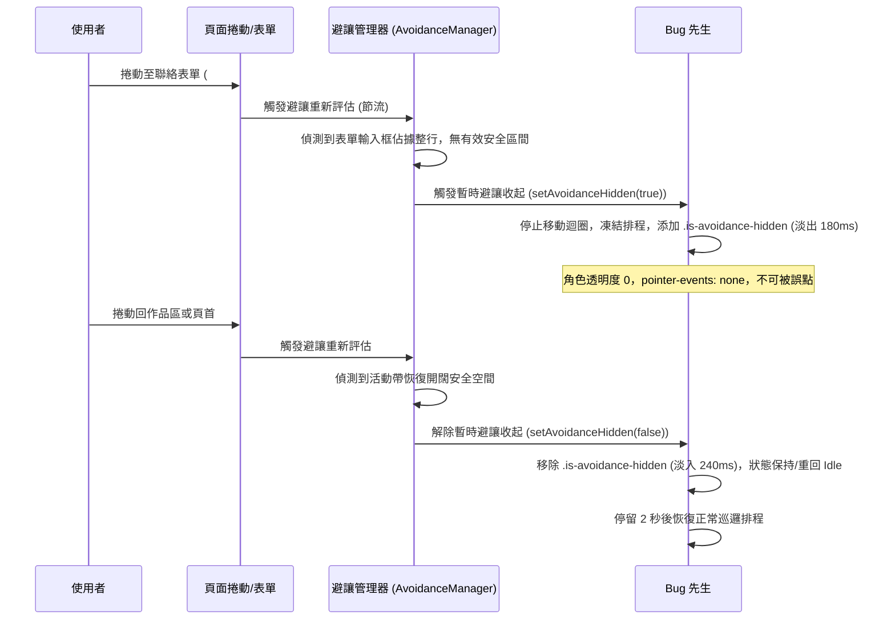

# PR2-PET-07B 實作規劃書：對話框邊界定位、短螢幕適配與重要互動區域避讓

- **Task ID**: PR2-PET-07B
- **相關 PR**: PR #2 (`emmakuo1019/Web#2`，分支 `plan/pr2-bug-pet`)
- **文件狀態**: 規劃完成，等待審查（Planning Complete — AWAITING PLAN REVIEW）
- **撰寫日期**: 2026-10-29
- **基準 Commit**: `9c50b1aa8eed014885d4e5e933768a667bb20d2b` (fix(pet): polish PR2-PET-07A focus visibility and docs)
- **前置任務**: PR2-PET-07A（角色對話、關閉互動與焦點管理）— 人工驗收已通過
- **限制**: 本次僅授權技術規劃與文件提交，不得修改 JS、HTML、CSS 或任何素材，亦不得提前實作。

---

## 1. 現況分析（Current State）

### 1.1 現有定位架構分析（CSS 與 DOM）
1. **容器層級與定位基線**：
   - 容器 `.pet-guide` 位於 `index.html` 尾端（主內容 `main` 之後、`.back-to-top-wrapper` 之前），CSS 設定為：
     ```css
     .pet-guide {
       position: fixed;
       left: 0;
       bottom: clamp(16px, 3vw, 32px);
       z-index: 1000;
       will-change: transform;
     }
     ```
   - 角色本體為 `.pet`（按鈕），寬高桌面 `64px × 64px`，手機（`<= 500px`）`48px × 48px`。
   - 水平位移完全由 JavaScript 的 `rAF` 迴圈計算 `posX` 並寫入 `.pet-guide.style.transform = "translateX(${posX}px)"`。

2. **對話框定位現況**：
   - `.pet-dialog` 位於 `.pet-guide` 容器內，作為 `.pet` 的同層後續元素：
     ```css
     .pet-dialog {
       position: absolute;
       bottom: calc(100% + 10px);
       right: 0;
       width: max-content;
       min-width: 160px;
       max-width: calc(100vw - clamp(16px, 3vw, 32px) * 2);
       /* ... */
     }
     ```
   - **現有機制的問題盤點**：
     - `right: 0` 表示對話框的**右邊緣**與 `.pet-guide` 的右邊緣（即角色按鈕右緣）對齊，對話框整體往角色的**左側**展開。
     - 當角色移動到螢幕最左側（`posX = minX = 12px`）並打開對話框時，因為對話框寬度通常為 `160px ~ 240px`，對話框會大幅溢出螢幕左側（`left < 0`），造成文字或關閉按鈕被裁切無法操作。
     - 當角色移動到螢幕最右側時，對話框雖然往左展，但在寬度較寬或 safe area 較大的手機上，若使用 `left: 0` 或其他對齊，又可能超出右側邊界。
     - 目前**完全沒有垂直方向的高度限制與捲動防護**：在橫向手機（例如高 320px ~ 400px）或短視窗中，對話框包含短句、3 個導覽按鈕、暫停按鈕、關閉按鈕，總高度可達 `260px ~ 300px`。加上角色本身與底部間距，對話框頂部會直接衝出視窗上方（`top < 0`），使用者看不到上方短句甚至關閉按鈕。

### 1.2 現有 Safe Area 與邊界量測現況
1. **JavaScript 現狀（`js/pet.js`）**：
   ```javascript
   function updateBoundaries() {
       const viewportWidth = window.innerWidth;
       const petWidth = petBtn.offsetWidth || 64;
       let safeLeft = 0;
       let safeRight = 0;
       try {
           const computed = getComputedStyle(document.documentElement);
           safeLeft = parseFloat(computed.getPropertyValue('--safe-area-inset-left')) || 0;
           safeRight = parseFloat(computed.getPropertyValue('--safe-area-inset-right')) || 0;
       } catch (e) {
           safeLeft = 0;
           safeRight = 0;
       }
       minX = PET_CONFIG.BOUNDARY_PADDING + safeLeft;
       maxX = Math.max(minX, viewportWidth - petWidth - PET_CONFIG.BOUNDARY_PADDING - safeRight);
       clampPosition();
   }
   ```
2. **存在缺陷**：
   - 僅讀取 CSS 自訂變數 `--safe-area-inset-left` 與 `--safe-area-inset-right`，然而在 `css/style.css` 中**完全未宣告**這兩個變數，導致 `safeLeft` 與 `safeRight` 恆為 0。
   - `index.html` 的 viewport meta 標籤為 `<meta name="viewport" content="width=device-width,initial-scale=1.0"/>`，**未設定 `viewport-fit=cover`**，在 iOS Safari 與具瀏海的現代行動裝置上無法正確啟用 `env(safe-area-inset-*)`。
   - 使用 `window.innerWidth` 作為視窗寬度，未考量 `window.visualViewport`。在手機鍵盤展開、頁面放大或某些行動瀏覽器中，`window.innerWidth` 不等於可視區域寬度。
   - 底部固定定位 `bottom: clamp(16px, 3vw, 32px)` 未計入 `env(safe-area-inset-bottom)`，在無 Home 鍵的 iPhone 上角色會與底部手勢條（Home Indicator）重疊。

### 1.3 重要互動區域現況盤點
盤點實際首頁所有可見互動元素：
1. **頂部導覽列（`.nav`）**：
   - `position: fixed; top: 0; left: 0; right: 0; height: var(--nav-height) (64px); z-index: 100;`。
   - 雖然 `.nav` 在最頂部，但在一般高度下 Bug 先生固定於視窗底部，二者垂直方向不重疊；但在極端超短視窗（高度 < 200px）或對話框往上延伸時可能產生垂直重疊。
2. **表單區域（`#myForm` 及其輸入項）**：
   - 包含 `#contact-name`、`#contact-company`、`#contact-email`、`#contact-info`（textarea）、`#send`（送出按鈕）。
   - 元素位於一般文件流（static/relative），但當使用者捲動到 `#contact-area` 時，Bug 先生如果正在底部走動，會直接遮擋使用者正在點選或輸入的 input、textarea 或「送出」按鈕。
   - 行動端表單 input 聚焦時，軟鍵盤升起，視窗可視高度大幅縮小，角色若停在輸入游標上方會徹底破壞輸入體驗。
3. **回到頁首按鈕（`.back`、`.back2`）**：
   - 位於 `.back-to-top-wrapper`，在 `index.html` 第 125–128 行。
   - 位於頁面底部一般文件流內，非 fixed 懸浮。但當捲動至頁尾附近時，元素恰好會進入視窗底部活動帶，若角色走過去會覆蓋按鈕。
4. **頁尾連結（`.footer` 內連結）**：
   - 包含 Instagram、Facebook 外連 `<a>` 標籤，以及未來 08B 的召回按鈕。捲動至底部時同樣會進入角色活動帶。
5. **作品區（`#projects .card-link`）**：
   - 由 `js/list.js` 動態渲染生成卡片，每張卡片皆為 `<a class="card-link">`，使用者捲動閱讀時，卡片下緣或按鈕可能進入視窗底部的角色活動帶。

---

## 2. 任務範圍（Scope / Out of Scope）

### 2.1 實作範圍（In Scope for 07B）
1. **對話框邊界跟隨與 Clamp**：
   - 對話框以角色按鈕為錨點，動態計算水平偏移，確保在螢幕最左、最右時對話框左右兩側與視窗邊緣至少維持 12px 安全距離（含 safe-area）。
   - 短視窗／橫向手機適配：動態或 CSS 限制對話框 `max-height`，並啟用內部捲動（`overflow-y: auto`），保證關閉按鈕、暫停按鈕與短句皆可操作。
2. **Safe Area 與手機 Viewport 計算校準**：
   - 在 CSS 根節點定義 safe-area 變數並相容 `env(safe-area-inset-*)`。
   - 在 JS 中建立統一 Viewport 幾何查詢器，支援 `visualViewport`（若存在）與 `window` 的平滑退化。
   - 監聽 `resize`、`orientationchange`、`visualViewport.resize` 與 `visualViewport.scroll`。
3. **重要互動區域避讓機制（Avoidance System）**：
   - 針對可視且可能重疊的元素：`.nav`（短視窗防護）、`#myForm` 互動項（input/textarea/submit）、`.back` / `.back2`、Footer 互動連結、可視作品卡片。
   - 計算視窗底部「角色活動帶」（Pet Active Band）與各元素幾何形狀的交集，動態產生水平禁止區間（Excluded Intervals），將行走範圍切分為一個或多個「安全區間」（Safe Intervals）。
   - 角色在所在安全區間內巡邏；若當前無足夠安全區間（可用寬度小於角色寬度 + 間距），觸發「暫時避讓收起」（Temporary Avoidance Hide）。
   - 當頁面捲動或視窗改變、空間恢復後，角色重新出現並回到 `Idle`。
4. **表單與焦點保護（Focus & Mobile Keyboard）**：
   - 監聽全域表單控制項（`input`、`textarea`、`select`）的 `focusin` 與 `focusout`。
   - 表單聚焦時立即暫時收起角色與對話框，確保不遮擋軟鍵盤與游標，且絕不搶奪使用者的鍵盤焦點。
   - 表單失焦後，恢復角色顯示（若無其他避讓阻礙）。
5. **效能與穩定度控制**：
   - 幾何量測與安全區間計算集中於 `scroll`（防抖/節流）、`resize` 或焦點事件，不在每幀 `rAF` 迴圈中重測 DOM。
   - 單一 rAF 迴圈僅負責讀取已快取的 `[minX, maxX]` 並更新 `transform`。

### 2.2 明確排除事項（Out of Scope）
- **禁止實作 08A Debug 與持久隱藏**：不新增 Debug 按鈕，不讀寫 `sessionStorage`（例如 `emma.pet.hidden.v1`）。
- **禁止實作 08B Footer 召回按鈕**：不修改 Footer HTML，不實作召回入口。
- **禁止導入外部物理引擎**：不使用 Matter.js 或其他物理碰撞套件處理角色避讓。
- **禁止修改素材**：不修改 `picture/pet/` 下的圖片。
- **禁止重構無關模組**：不觸碰 `js/home.js` 中的拉繩動畫、標題特效等。

---

## 3. 座標系統與 Viewport 計算（Coordinate System）

### 3.1 視窗基準與 Visual Viewport
在行動裝置（特別是 iOS Safari 與 Android Chrome）開啟軟鍵盤或縮放時，`window.innerWidth` / `window.innerHeight`（Layout Viewport）往往保持不變，而使用者實際看到的操作區域由 `window.visualViewport` 決定。

```
+--------------------------------------------------------+  <- Layout Viewport
| [Fixed Nav]                                            |
|                                                        |
|      +------------------------------------------+      |  <- Visual Viewport
|      |                                          |      |     (window.visualViewport)
|      | 可視內容區                               |      |
|      |                                          |      |
|      | [Pet Dialog] (Clamp 於 Visual Viewport)   |      |
|      | [Pet] (沿著 Visual Viewport 底部活動)     |      |
|      +------------------------------------------+      |
|                                                        |
| [軟鍵盤升起區域 / Virtual Keyboard]                     |
+--------------------------------------------------------+
```

#### 幾何查詢器（Viewport Geometry Resolver）
```javascript
function getViewportGeometry() {
    const vv = window.visualViewport;
    const width = vv ? vv.width : window.innerWidth;
    const height = vv ? vv.height : window.innerHeight;
    const offsetLeft = vv ? vv.offsetLeft : 0;
    const offsetTop = vv ? vv.offsetTop : 0;
    
    // Safe area 計算
    let safeLeft = 0, safeRight = 0, safeBottom = 0;
    try {
        const cs = getComputedStyle(document.documentElement);
        safeLeft = parseFloat(cs.getPropertyValue('--safe-area-left')) || 0;
        safeRight = parseFloat(cs.getPropertyValue('--safe-area-right')) || 0;
        safeBottom = parseFloat(cs.getPropertyValue('--safe-area-bottom')) || 0;
    } catch (e) {}

    return {
        width,
        height,
        offsetLeft,
        offsetTop,
        safeLeft,
        safeRight,
        safeBottom
    };
}
```

### 3.2 CSS Safe Area 注入規劃
在 `css/style.css` 根部引入環境變數映射：
```css
:root {
  --safe-area-left: env(safe-area-inset-left, 0px);
  --safe-area-right: env(safe-area-inset-right, 0px);
  --safe-area-bottom: env(safe-area-inset-bottom, 0px);
}

.pet-guide {
  position: fixed;
  left: 0;
  bottom: calc(clamp(16px, 3vw, 32px) + var(--safe-area-bottom));
  z-index: 1000;
  will-change: transform;
  pointer-events: none; /* 大面積透明區穿透，僅子按鈕可點 */
}

.pet, .pet-dialog {
  pointer-events: auto; /* 子元素恢復點擊 */
}
```
*註：在 `index.html` 的 meta viewport 應補充 `viewport-fit=cover` 以正確啟用安全區域。*

---

## 4. 對話框邊界定位與短螢幕適配（Panel Positioning & Clamp）

### 4.1 水平邊界 Clamp 演算法
對話框本體是 `.pet-guide` 內的子元素。`.pet-guide` 的位置透過 `transform: translateX(posX)` 決定（基準為螢幕左側 `0`）。
設：
- `V_w`：可視寬度（`viewport.width`）
- `S_L`：左安全邊界（`12px + safeLeft`）
- `S_R`：右安全邊界（`12px + safeRight`）
- `posX`：角色目前相對於視窗左側的水平位移
- `petWidth`：角色寬度（桌面 64px / 手機 48px）
- `dialogWidth`：對話框當前渲染寬度（`petDialog.offsetWidth`）

#### 設計策略：角色中心對齊 + 邊界 Clamp
對話框視覺上理想狀態是以角色頂部中心對齊（或角色上方展開）。
我們將對話框的 CSS 改為 `left: 0; right: auto;`，並透過獨立的 CSS 變數 `--dialog-shift-x` 控制對話框相對於角色的水平位移：

```
對話框在視窗中的絕對 X 座標 = posX + dialogShiftX
```
若希望對話框預設靠角色右側展開或置中：
1. 理想無拘束偏移量：
   `desiredDialogLeft = posX + (petWidth / 2) - (dialogWidth / 2)`（置中）或直接依現況從角色邊緣延伸。
2. 進行可視區間 Clamp：
   - 視窗左極限：`minAllowedDialogX = S_L`
   - 視窗右極限：`maxAllowedDialogX = V_w - S_R - dialogWidth`
   - 若 `maxAllowedDialogX < minAllowedDialogX`（螢幕寬度小於對話框寬度 + 24px），則對話框滿版置中：
     `clampedDialogX = S_L`，且 `dialog.style.maxWidth = (V_w - S_L - S_R) + 'px'`。
   - 否則：
     `clampedDialogX = Math.max(minAllowedDialogX, Math.min(desiredDialogLeft, maxAllowedDialogX))`
3. 相對角色的內部偏移量：
   `dialogShiftX = clampedDialogX - posX`
4. 寫入 DOM：
   `petDialog.style.transform = "translateX(${dialogShiftX}px)"`（若有開啟過渡動畫，與 `translateY` 結合）。

> [!TIP]
> **無跳動保證**：
> 角色在移動時對話框本是關閉的；只有點擊開啟（進入 `Happy`）時，角色會立即停步（`stopMovementLoop()`）。因此，對話框 Clamp 的計算只在開啟的當下執行一次，或者在開啟狀態下視窗 `resize` 時校正一次，角色在行走時不會有對話框的逐幀計算，徹底杜絕畫面跳動。

### 4.2 垂直短視窗與內部捲動適配（Short Viewports）
在橫向手機（例如 iPhone 橫置高約 375px ~ 390px，扣除瀏覽器網址列後僅剩約 280px ~ 320px）：
1. 角色佔高：`48px`（手機）+ 底部間距約 `16px` = `64px`。
2. 可用垂直空間：`availableHeight = viewport.height - petHeight - bottomPadding - topSafePadding (12px)`。
3. 若 `availableHeight < 280px`：
   - 為對話框動態或透過 CSS 設定 `max-height: calc(100vh - 100px)`（或 JS 精準計算 `max-height = Math.max(160, availableHeight) + 'px'`）。
   - 設定對話框為 Flex Column：
     ```css
     .pet-dialog {
       display: flex;
       flex-direction: column;
       max-height: calc(100vh - 110px);
       overflow-y: auto;
       -webkit-overflow-scrolling: touch;
     }
     .pet-speech {
       flex-shrink: 0;
     }
     .pet-options {
       flex-shrink: 0;
     }
     .pet-controls {
       flex-shrink: 0;
     }
     ```
   - 即使高度僅有 200px，使用者仍可藉由面板內部捲動滑至最下方點選「關閉」或「暫停走動」，保證核心功能不被截斷。

---

## 5. 重要區域避讓機制（Avoidance Design）

### 5.1 底部活動帶（Pet Active Band）定義
角色固定在視窗底部，其在視窗中佔據一條垂直帶狀區域：
- **活動帶頂部（Band Top）**：
  `bandTop = viewport.height - (petBottomInset + petHeight + 10px)`
  *(若對話框開啟，活動帶頂部擴展至對話框頂部；但通常避讓針對的是行走中的角色)*
- **活動帶底部（Band Bottom）**：
  `bandBottom = viewport.height`

任何網頁互動元素的視窗矩形（`rect = el.getBoundingClientRect()`），若滿足：
```javascript
rect.bottom > bandTop && rect.top < bandBottom
```
即表示該元素在當前捲動位置下，**垂直投影已與角色的行走通道重疊**。

```
+--------------------------------------------------------------+
| 網頁主要內容 (不相交)                                         |
|                                                              |
| [作品卡片 1]            [作品卡片 2]                          |
|                                                              |
|----------------- Band Top -----------------------------------|
|                               [#send 按鈕]  <- 垂直相交！     |
| [Pet Walking] ➔ ➔ ➔ (禁止進入此 X 區間)                      |
+----------------- Band Bottom --------------------------------+
```

### 5.2 盤點清單與選擇器
在頁面中，僅收集目前可見（`offsetWidth > 0 && offsetHeight > 0` 且 `visibility !== 'hidden'`）的指定關鍵互動元素：
1. **導覽列**：`.nav`（僅在超短視窗 `viewport.height < 150px` 時才可能垂直相交）。
2. **表單**：`#myForm input, #myForm textarea, #myForm button`。
3. **回頂按鈕**：`.back:visible, .back2:visible`（或直接選取 `.back-to-top-wrapper`）。
4. **頁尾連結**：`.footer a, .footer button`。
5. **作品互動卡片**：`#projects .card-link`。

### 5.3 Excluded Intervals（排除區間）與 Safe Intervals（安全區間）計算
1. **安全緩衝區間（Padding）**：
   設緩衝距離 `AVOID_PADDING = 16px`。
2. **計算各重疊元素的水平禁止區間**：
   對於每個與「活動帶」垂直相交的可見元素 `el`：
   ```javascript
   const rect = el.getBoundingClientRect();
   // 角色是以 left 為基準 posX，角色寬度為 petWidth
   // 當 posX + petWidth > rect.left - 16 && posX < rect.right + 16 時會重疊
   // 因此禁止角色左緣 posX 進入的區間為：
   const blockedStart = Math.max(minX, rect.left - petWidth - AVOID_PADDING);
   const blockedEnd = Math.min(maxX, rect.right + AVOID_PADDING);
   ```
3. **區間合併（Interval Merging）**：
   將所有重疊元素產生的 `[blockedStart, blockedEnd]` 進行排序並合併重疊區間，得到一組不相交的禁止區間。
4. **求反向安全區間（Safe Intervals）**：
   從可視總區間 `[minX, maxX]` 中扣除所有禁止區間，得到若干可用子區間：
   `[ [s1, e1], [s2, e2], ... ]`。
   - 過濾掉寬度小於角色安全迴轉寬度（例如 `width < petWidth * 0.5`）的狹窄死胡同。

### 5.4 角色在安全區間內的行為
1. **若存在至少一個有效安全區間**：
   - 檢查角色當前的 `posX` 落在落在哪個安全區間：
     - 若 `posX` 正處於某個安全區間 `[s_k, e_k]` 內：
       更新當前巡邏邊界為 `currentMinX = s_k`，`currentMaxX = e_k`。
       角色在該安全區間內自由折返走動，絕不越界踩入被遮擋元素。
     - 若因為使用者捲動，原本安全的位置突然被元素侵入（`posX` 落在禁止區間）：
       角色優先平滑走向最近的安全區間邊界；若無可退避的安全區間，進入暫時避讓收起。
2. **若沒有任何安全區間（空間不足）**：
   - 當前可視底部的按鈕或表單占滿了水平寬度（例如手機寬度 360px 下，表單的大輸入框橫跨整個螢幕）。
   - 此時觸發 **「暫時避讓收起」（Temporary Avoidance Hide）**。

---

## 6. 暫時避讓收起設計（Temporary Hide Design）

### 6.1 暫時避讓收起 vs FSM Hidden 的嚴格區分
這兩者在語意、生命週期與儲存機制上截然不同，必須嚴格隔離：

| 比較維度 | 暫時避讓收起（Temporary Avoidance Hide） | FSM 核心狀態：Hidden（08A Debug） |
| :--- | :--- | :--- |
| **觸發原因** | 頁面捲動至密集互動區、表單 input 聚焦、無行走安全空間 | 使用者主動點擊「Debug」按鈕 |
| **FSM 狀態** | 核心 FSM 保持 `Idle` 或內部標記 `isAvoidanceHidden = true` | 核心 FSM 轉移至 `PET_STATES.HIDDEN` |
| **恢復機制** | 捲動離開阻礙區、表單失焦、空間恢復時**自動淡入恢復** | 必須由使用者至 Footer 點擊「召回按鈕」主動召回 |
| **Storage 記憶** | **絕不寫入** `sessionStorage` 或 `localStorage` | 寫入 `sessionStorage`（`emma.pet.hidden.v1`） |
| **對話框行為** | 若對話框開啟中遇到避讓，自動關閉對話框，不觸發未預期的焦點跳動 | 關閉對話框，焦點轉移至頁面安全主標題 |
| **DOM 樣式** | 透過 CSS class `.is-avoidance-hidden` 控制 `opacity: 0; pointer-events: none;` | 透過 `.is-hidden` 或 DOM `hidden = true` 徹底隱藏 |

### 6.2 避讓收起與恢復流程


---

## 7. 表單與焦點保護（Focus & Mobile Behavior）

### 7.1 表單控制項聚焦保護
1. **監聽目標**：
   在 `document` 上監聽 `focusin` 與 `focusout`：
   ```javascript
   const FORM_SELECTOR = 'input, textarea, select, #myForm button';
   ```
2. **行為契約**：
   - 當 `document.activeElement` 匹配表單元素且非角色面板自身按鈕時：
     - **立即將角色與面板收起**（加入 `isAvoidanceHidden` 旗標）。
     - 暫停移動迴圈，避免背景運算。
     - **絕不呼叫任何會改變焦點的函式**（禁止 `blur()`、禁止 `petBtn.focus()`），保證使用者的輸入法游標完全不受干擾。
   - 當表單失焦（`focusout`）時：
     - 使用防抖（`setTimeout 50ms`）檢查新聚焦元素是否依然是表單項。
     - 若已離開表單，且頁面可視空間允許，解除避讓收起，角色重新淡入為 `Idle`。

### 7.2 軟鍵盤展開處理
1. 在行動裝置上，表單聚焦往往伴隨軟鍵盤開啟，`visualViewport.height` 急劇縮小（可能只剩 200px ~ 300px）。
2. 此時因為表單聚焦機制已將角色收起，角色完全不會出現在軟鍵盤上緣干擾操作。
3. 失焦且鍵盤收起時，`visualViewport.resize` 觸發，重新量測 `updateBoundaries()` 與安全區間，確保角色重新出現時落在正確的底部可視位置。

### 7.3 與 06C 暫停原因及 07A 對話框的相容性
- **06C 相容性**：
  暫時避讓收起時，`PauseManager` 加入一個內部原因 `'avoidance'`（或直接透過 `isMovementAllowed()` 判斷）。當解除避讓時移除該原因。其他原因如 `user` 手動暫停、`reducedMotion` 依然受到嚴格保護，絕不會因為避讓恢復而意外解除使用者的手動暫停。
- **07A 相容性**：
  若在 `Happy` 對話框開啟狀態下發生強制避讓（例如使用者捲動到表單並點選輸入框）：
  對話框應立即安靜關閉（轉入 `Idle`），清除短句，但不觸發 07A 的「外部點擊返焦至角色」邏輯，確保焦點順暢停留在輸入框。

---

## 8. 效能與穩定度策略（Performance Strategy）

### 8.1 幾何量測頻率控制
頻繁呼叫 `getBoundingClientRect()` 會引發瀏覽器的強制同步布局（Reflow/Layout Thrashing），絕對不能放在每幀（`16ms`）的 `rAF` 內執行。

#### 執行策略：
1. **單一 rAF 迴圈（`movementStep`）**：
   - 僅執行：`posX += direction * speed * deltaSeconds`。
   - 比對當前快取的 `currentMinX` 與 `currentMaxX`。
   - 寫入 `transform: translateX(...)`。
   - **完全不呼叫任何 DOM 量測 API**。
2. **量測觸發時機（Event-Driven Measurement）**：
   - **頁面捲動（`window.addEventListener('scroll')`）**：
     採用 `requestAnimationFrame` 節流（`scrollTicking`）或 `100ms` 的節流器（Throttle），捲動期間最多每 100ms 計算一次活動帶相交元素。
   - **視窗尺寸改變（`resize` / `visualViewport.resize`）**：
     使用防抖（Debounce 150ms），在視窗穩定後重測全域邊界與區間。
   - **表單焦點（`focusin` / `focusout`）**：
     由事件直接觸發，開銷微小。
   - **DOM 動態載入（`#projects` 卡片載入完成）**：
     在 `data/projects.json` 載入完成後觸發一次重新計算。

---

## 9. 實作步驟規劃（Implementation Steps）

若本規劃經人工審查核准，後續實作授權將依下列順序進行：

1. **Step 1: CSS Safe Area 變數與基礎穿透樣式**
   - 在 `css/style.css` 補齊 `:root` 的 `--safe-area-*` 變數與 `pet-guide` 穿透／子項 pointer-events 樣式。
   - 替 `.pet-dialog` 加入 Flex 垂直排版、`max-height` 及內部捲動屬性。
   - 替 `.pet-guide` 加入 `.is-avoidance-hidden` 的透明度與過渡樣式。

2. **Step 2: 幾何查詢器與 Viewport 統一計算**
   - 在 `js/pet.js` 中封裝 `getViewportGeometry()`。
   - 校正 `updateBoundaries()`，正確計入左右 safe-area 與視窗寬度。

3. **Step 3: 對話框 Clamp 演算法實作**
   - 在 `render(HAPPY)` 開啟對話框時，計算對話框的水平偏移量並寫入 `--dialog-shift-x`（或 `translateX`），確保對話框左右不溢出視窗。
   - 測試最左側（`posX = minX`）與最右側（`posX = maxX`）開啟對話框的顯示情況。

4. **Step 4: 避讓管理器（AvoidanceManager）實作**
   - 實作互動元素快取與活動帶相交判定函式。
   - 實作排除區間合併與安全區間提取演算法。
   - 接入捲動節流（Scroll Throttle）與視窗變化監聽。

5. **Step 5: 表單焦點與暫時收起聯動**
   - 實作全域表單 `focusin` / `focusout` 監聽。
   - 實作 `setAvoidanceHidden(true/false)`，確保不干擾輸入焦點。

6. **Step 6: 控制器擴充與多裝置邊界驗證**
   - 在 `window.__petController` 暴露避讓狀態查詢與安全區間檢查介面，供自動化與人工驗收測試。

---

## 10. 技術風險與替代權衡（Risks / Trade-offs）

| 風險項目 | 潛在影響 | 因應對策 / 簡化方案 |
| :--- | :--- | :--- |
| **R1: 捲動計算造成頁面卡頓** | 快速捲動時若密集計算 `getBoundingClientRect()`，低階手機可能掉幀。 | **節流優化**：以 rAF 節流捲動計算；且若角色正處於收起狀態，捲動時不重複計算，直到捲動停止後再評估一次。 |
| **R2: 安全區間破碎造成角色頻繁轉向** | 若畫面上有多個分散按鈕，安全區間可能被切分成許多極窄區塊，角色看起來像在原地抽搐。 | **區間下限過濾**：安全區間寬度若小於 `100px`（約 1.5 倍角色寬），直接將其標記為無效；若全頁可用區間太碎，寧可暫時避讓收起，也不進行微幅抽搐走動。 |
| **R3: 對話框 Clamp 動畫衝突** | CSS 原有 `translateY(6px) -> translateY(0)` 開啟過渡，若 JS 寫入 `transform: translateX(...)` 可能覆蓋原有垂直淡入動畫。 | **分層處理**：在 CSS 中以 `transform: translate(var(--dialog-shift-x, 0px), var(--dialog-shift-y, 0px))` 統一管理，或外層包裹 position 偏移容器，讓 CSS 動畫層與 JS 座標層分離。 |
| **R4: 行動端軟鍵盤 Resize 誤判** | 某些 Android 瀏覽器軟鍵盤彈出時不觸發 `visualViewport.resize`，或觸發順序不一致。 | **雙重防護**：以 `focusin` 為第一道防線立即收起角色，`resize` 僅為輔助校正，確保鍵盤彈出前角色已經隱藏。 |

---

## 11. 驗收標準（Acceptance Criteria）

> [!NOTE]
> 本任務為技術規劃階段，所有驗收項目均為規劃待測項目，目前標記為 **NOT TESTED**。

### 11.1 對話框邊界與短螢幕驗收
| AC ID | 驗收項目 | 通過標準 | 狀態 |
| :--- | :--- | :--- | :--- |
| AC-33 | 角色移動至最左邊界（`minX`）時開啟對話框 | 對話框左側距離視窗邊緣至少 12px，不被裁切 | NOT TESTED |
| AC-34 | 角色移動至最右邊界（`maxX`）時開啟對話框 | 對話框右側距離視窗邊緣至少 12px，不被裁切 | NOT TESTED |
| AC-35 | 320px 窄螢幕下開啟對話框 | 對話框完整顯示於螢幕內，文字正常換行無橫向溢出 | NOT TESTED |
| AC-36 | 視窗高度 <= 400px（橫向短視窗）開啟對話框 | 對話框高度不超過視窗，出現內部垂直捲軸，所有按鈕皆可捲出並點擊 | NOT TESTED |
| AC-37 | 對話框開啟與關閉無畫面異常閃爍或跳動 | 動畫平滑過渡，位置固定於角色上方 | NOT TESTED |

### 11.2 重要互動區域避讓驗收
| AC ID | 驗收項目 | 通過標準 | 狀態 |
| :--- | :--- | :--- | :--- |
| AC-38 | 捲動至 `#myForm` 且輸入欄位進入底部活動帶 | 角色避開輸入框與送出按鈕的水平投影區間，絕不重疊 | NOT TESTED |
| AC-39 | 底部活動帶被互動元素完全佔滿無安全空間 | 角色平滑暫時淡出收起；捲動離開後平滑恢復出現 | NOT TESTED |
| AC-40 | 捲動至頁尾 `.back` / `.back2` 進入底部活動帶 | 角色巡邏範圍被限制於按鈕兩側安全區間，不遮擋回頂按鈕 | NOT TESTED |
| AC-41 | 捲動至頁尾 Footer 連結進入底部活動帶 | 角色巡邏範圍避開 Footer 連結與未來召回區域 | NOT TESTED |
| AC-42 | 暫時避讓收起期間 | `pointer-events: none`，不攔截底層點擊，不寫入 `sessionStorage` | NOT TESTED |

### 11.3 表單與焦點保護驗收
| AC ID | 驗收項目 | 通過標準 | 狀態 |
| :--- | :--- | :--- | :--- |
| AC-43 | 點擊/聚焦任何表單輸入欄位（name/email/info） | Bug 先生與對話框立即暫時收起，輸入游標不失焦 | NOT TESTED |
| AC-44 | 表單輸入完成並點選外部或失焦 | 角色在空間允許下重新恢復顯示，維持 `Idle` | NOT TESTED |
| AC-45 | 暫時避讓恢復後 | 06C 暫停原因集合（如使用者手動暫停）未被覆蓋或破壞 | NOT TESTED |

---

## 12. 回歸測試驗收（Regression Tests）

| REG ID | 測試模組 | 驗收標準 | 狀態 |
| :--- | :--- | :--- | :--- |
| REG-17 | **06B 邊界與移動** | 左右邊界碰撞轉向正常，不因避讓演算法產生瞬移或卡死 | NOT TESTED |
| REG-18 | **06C 手動暫停** | 手動暫停走動後，避讓收起再恢復時，角色依然維持手動暫停 | NOT TESTED |
| REG-19 | **06C Reduced Motion** | 系統啟用減少動態偏好時，避讓收起與恢復不產生多餘位移動畫 | NOT TESTED |
| REG-20 | **07A Escape 與關閉按鈕** | 對話框開啟時，Escape 鍵與關閉按鈕依然正常運作並返回焦點 | NOT TESTED |
| REG-21 | **07A 三個導覽按鈕** | 點選作品、關於、聯絡按鈕，平滑捲動且焦點正常轉移 | NOT TESTED |

---

## 13. 開放決策事項（Open Questions & Recommendations）

### Q1: 避讓收起的動畫與呈現方式
- **問題**：當角色在捲動中發現無安全空間需要暫時收起時，採用何種過渡視覺？
- **選項**：
  - **(A) 快速淡出/淡入（推薦）**：`opacity: 0; transition: opacity 0.2s ease`，行為簡單、穩定，不引起視覺跳動。
  - **(B) 底部向下滑出/向上滑入**：`transform: translateY(100%)`，具備角色鑽入地下的趣味感，但可能與目前 X 位移的 transform 產生複雜覆蓋。
  - **(C) 無動畫立即隱藏**：`display: none`，最省資源但略顯生硬。
- **建議方案**：**(A) 快速淡出/淡入**。在 Reduced Motion 下則直接無動畫切換。

### Q2: 作品區卡片（`.card-link`）的避讓粒度
- **問題**：作品區包含多個卡片，捲動時卡片陸續經過底部活動帶。是否需將每一張卡片都納入水平避讓？
- **選項**：
  - **(A) 僅避讓按鈕與表單，作品卡片允許角色重疊（簡化方案）**：作品區面積大，若卡片也避讓，在平板或手機上角色將無處可去而長時間處於隱藏狀態。
  - **(B) 完整避讓所有可見卡片（規格推薦）**：計算所有與活動帶垂直相交的卡片水平區間。若無空間則角色安靜隱藏，凸顯「角色服務於作品閱讀，不遮擋作品」的規格核心原則。
- **建議方案**：**(B) 完整避讓**。若人工審核認為角色收起過於頻繁，可由人工決策切換至 (A)。

---

**AWAITING PLAN REVIEW**

本規劃文件已完成，請審查規劃內容。審查通過前嚴格禁止開始撰寫任何程式碼。
